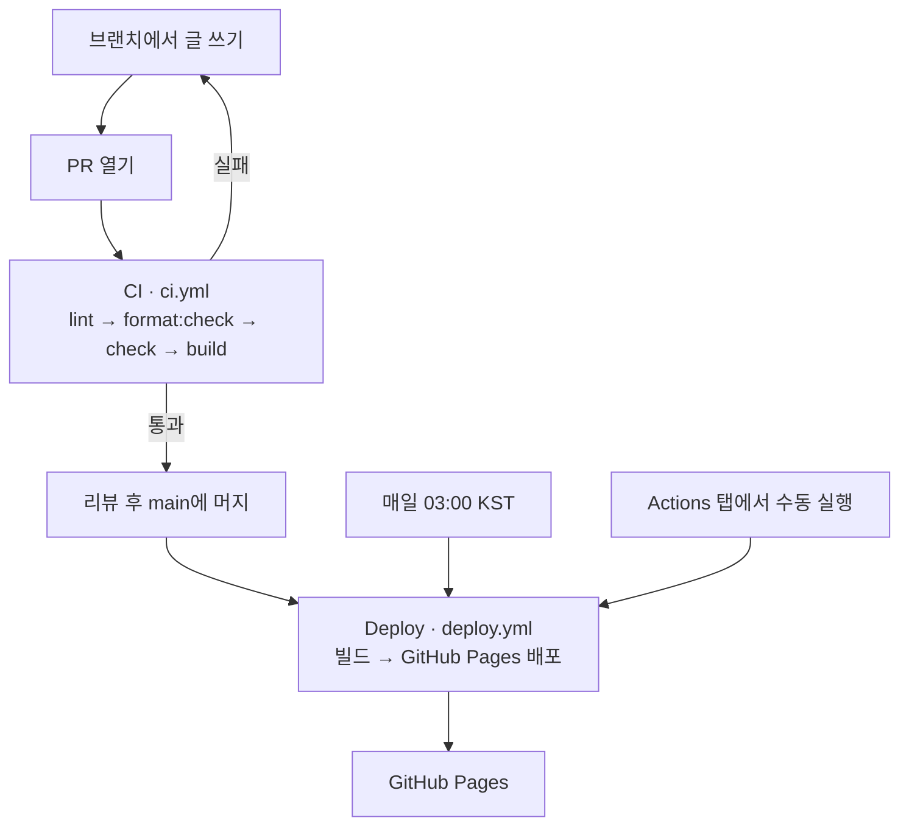
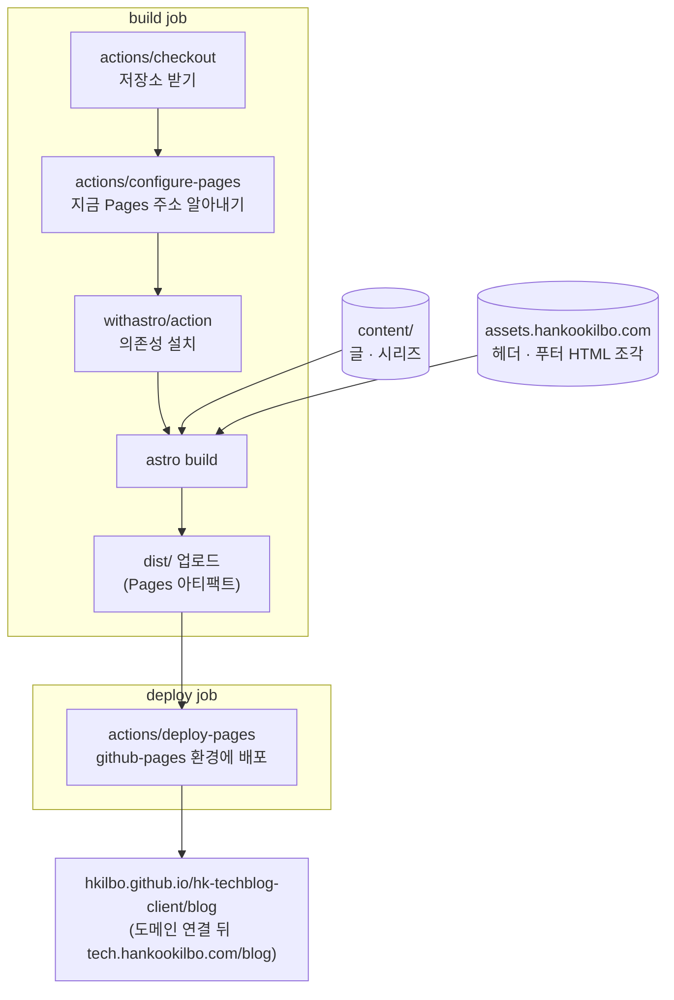

# 한국일보 기술 블로그

한국일보 개발자와 프로덕트 팀이 일하며 배운 것을 쓰는 블로그다(https://tech.hankookilbo.com).

글은 마크다운 파일로 쓰고 PR로 올린다. PR이 main에 머지되면 GitHub Actions가 사이트를 빌드해 GitHub Pages에 배포한다. 따로 운영하는 서버나 CMS는 없다.

| 하려는 일                     | 읽을 곳                                                                         |
| ----------------------------- | ------------------------------------------------------------------------------- |
| 글 올리기                     | [글 올리기](#글-올리기)                                                         |
| 사이트 코드 고치기            | [로컬에서 실행하기](#로컬에서-실행하기), [ARCHITECTURE.md](./ARCHITECTURE.md)   |
| 배포가 돌아가는 방식 이해하기 | [GitHub Actions로 배포되는 원리](#github-actions로-배포되는-원리)               |
| 저장소 처음 설정하기          | [처음 한 번 설정하기](#처음-한-번-설정하기)                                     |

## 글 올리기

1. main에서 브랜치를 만든다.
2. `content/posts/` 아래에 글 폴더를 만든다. 폴더 이름이 글 주소 `/blog/posts/<폴더 이름>/`가 되므로 영문 소문자와 하이픈으로 짓는다. 올린 뒤에는 이름을 바꾸지 않는다(주소와 댓글 스레드가 바뀐다).
3. 글 폴더에 `index.md`와 표지 이미지 `cover.jpg`를 넣는다.
4. `index.md`에 [글 틀](#글-틀)을 붙여 넣고, [frontmatter](#frontmatter-쓰기)와 [본문](#본문-쓰기)을 고친다.
5. `pnpm dev`로 띄워 `http://localhost:4321/blog/posts/<폴더 이름>/`에서 확인한다.
6. PR을 올린다. CI가 통과하고 리뷰를 받으면 main에 머지한다.

```
content/posts/my-first-post/
├── index.md       # frontmatter + 본문
├── cover.jpg      # 표지(필수)
└── diagram.png    # 본문 이미지(필요할 때)
```

머지하면 Deploy 워크플로가 끝나는 대로 사이트에 반영된다. 진행 상황은 저장소의 Actions 탭에서 본다. 홈 글 목록과 RSS(`/blog/rss.xml`)에는 자동으로 들어간다.

초안 기능은 없다. main에 머지한 글은 바로 공개된다.

### 글 틀

새 글은 이 틀을 `index.md`에 붙여 넣고 고친다. 저장소에 예시 글을 두지 않으므로 이 틀이 기준이다.

````md
---
title: "글 제목"
summary: "글 목록과 공유 미리보기에 보이는 한두 줄 요약"
category: tech
topic: frontend
tags: ["Astro", "GitHub Actions"]
author: { name: "이름", role: "Frontend Engineer" }
publishedAt: 2026-11-05
readingMinutes: 8
cover: ./cover.jpg
---

첫 문단은 소제목 없이 바로 쓴다.

## 첫 번째 소제목

본문. 소제목(`##`)이 글 오른쪽 목차에 나온다.


```ts
const hello = 'world';
```
````

### frontmatter 쓰기

frontmatter는 `index.md` 맨 위 `---` 사이에 쓰는 글 정보다([글 틀](#글-틀)의 윗부분).

| 필드             | 필수      | 값                                                                   |
| ---------------- | --------- | -------------------------------------------------------------------- |
| `title`          | 필수      | 글 제목                                                              |
| `summary`        | 필수      | 글 목록에 보이는 요약                                                |
| `category`       | 필수      | `tech`, `product`, `culture` 중 하나                                 |
| `topic`          | Tech 글만 | `frontend`, `backend`, `ai-db`, `cloud` 중 하나                      |
| `tags`           | 선택      | 문자열 배열                                                          |
| `author`         | 필수      | `{ name, role }`. 인터뷰 글이면 인터뷰한 사람                        |
| `publishedAt`    | 필수      | 발행일. `YYYY-MM-DD`                                                 |
| `readingMinutes` | 필수      | 읽는 시간(분). 자동으로 계산하지 않으므로 직접 적는다. 공백을 뺀 본문 글자 수 ÷ 500을 올림한다 |
| `cover`          | 필수      | 표지 이미지 경로. 글 폴더에 두면 `./cover.jpg`. 가로 1200px 이상이 좋다(글 목록 썸네일과 공유 미리보기 1200×630에 쓰인다). SVG도 된다. 목록에서는 SVG 그대로 쓰고, 공유 미리보기는 JPG로 그린다 |
| `kind`           | 선택      | 개발자 인터뷰 글이면 `interview`. Culture 첫 화면 인터뷰 캐러셀에 나오고, 표지는 세로 3:4 사람 사진이 카드에 맞는다 |
| `series`         | 선택      | 시리즈 글이면 `{ id, order }`. [시리즈로 묶기](#시리즈로-묶기) 참고  |

형식은 `src/content.config.ts`가 정한다. 필수 필드가 빠지거나, 정해진 값이 아니거나, `cover` 파일이 없으면 빌드가 실패한다. 그런 PR은 CI를 통과하지 못한다.

### 본문 쓰기

- 소제목은 `##`로 쓴다. `##` 소제목이 글 오른쪽 목차에 나온다. 글 제목(`title`)이 이미 h1이므로 `#`은 쓰지 않는다.
- 이미지는 글 폴더에 넣고 ``처럼 상대 경로로 쓴다. 빌드할 때 Astro가 이미지를 최적화한다.
- 코드 블록에는 언어를 적는다(예: ` ```ts `). 언어 이름이 코드 블록 오른쪽 위에 나온다.
- 다른 글로 가는 링크는 `../<폴더 이름>/`처럼 상대 경로로 쓴다. `/blog/posts/…`로 쓰면 도메인을 연결하기 전 주소(`hkilbo.github.io/hk-techblog-client/blog/`)에서 깨진다.
- MDX 문법이 필요하면 `index.md` 대신 `index.mdx`로 쓴다.

### 시리즈로 묶기

여러 편으로 이어지는 글은 시리즈로 묶는다.

1. `content/series/<시리즈 id>.yaml`을 만들고, 표지 이미지를 같은 폴더에 둔다.

   ```yaml
   title: '시리즈 제목'
   description: '시리즈 소개 한두 줄'
   cover: ./my-series.jpg
   ```

2. 시리즈에 속한 글마다 frontmatter에 `series: { id: my-series, order: 1 }`을 넣는다. `id`는 yaml 파일 이름이고, `order`는 1부터 시작하는 편 순서다.

## 로컬에서 실행하기

Node 24와 pnpm 10이 필요하다. CI와 같은 버전이다. pnpm의 정확한 버전은 `package.json`의 `packageManager`에 있다.

```bash
pnpm install
pnpm dev
```

`pnpm dev`는 http://localhost:4321/blog/ 에 개발 서버를 띄운다(포트가 사용 중이면 다음 번호를 쓴다). 파일을 고치면 바로 반영된다. 주소에 `/blog`가 붙는 이유는 아래 [사이트 주소와 /blog](#사이트-주소와-blog)에 있다.

| 명령             | 하는 일                                                                       |
| ---------------- | ----------------------------------------------------------------------------- |
| `pnpm dev`       | 개발 서버. 고친 내용이 바로 반영된다                                          |
| `pnpm build`     | `dist/`에 배포할 정적 파일을 만든다                                           |
| `pnpm preview`   | `dist/`를 그대로 띄운다. 코드를 고쳐도 다시 빌드하기 전에는 바뀌지 않는다     |
| `pnpm dev:gh`, `pnpm build:gh`, `pnpm preview:gh` | 위 세 명령을 지금 배포 주소(`hkilbo.github.io/hk-techblog-client`) 기준으로 돌린다. 아래 [사이트 주소와 /blog](#사이트-주소와-blog) |
| `pnpm lint`      | ESLint로 코드 규칙과 import 경로를 검사한다                                   |
| `pnpm format`    | Prettier로 포맷을 고친다. `pnpm format:check`는 검사만 한다                   |
| `pnpm check`     | `astro check`로 타입 오류를 검사한다                                          |

PR을 올리기 전에 CI와 같은 순서로 돌려 본다.

```bash
pnpm lint && pnpm format:check && pnpm check && pnpm build
```

## GitHub Actions로 배포되는 원리

`.github/workflows/`에 워크플로가 두 개 있다.

- CI(`ci.yml`): PR을 검사만 한다.
- Deploy(`deploy.yml`): main의 코드를 빌드해 GitHub Pages에 올린다.

사이트는 빌드로 만든 HTML·CSS·JS·이미지 파일이 전부다. 그래서 서버 없이 GitHub Pages가 파일을 그대로 내보낸다.



### CI: PR마다 검사한다

PR을 열거나 PR에 커밋을 올릴 때마다 돈다. lockfile에 적힌 버전 그대로 의존성을 설치하고(`pnpm install --frozen-lockfile`), 아래 네 단계를 차례로 실행한다. 한 단계라도 실패하면 PR에 실패 표시가 붙는다.

| 단계                | 잡아내는 것                                        |
| ------------------- | -------------------------------------------------- |
| `pnpm lint`         | 코드 규칙, import 경로 규칙 위반                   |
| `pnpm format:check` | Prettier 포맷과 다른 파일                          |
| `pnpm check`        | 타입 오류                                          |
| `pnpm build`        | frontmatter 형식 오류, 없는 이미지, 페이지 빌드 오류 |

CI의 권한은 저장소 읽기(`contents: read`)뿐이다. 검사만 하고 배포는 하지 않는다.

### Deploy: main에 들어오면 배포한다

Deploy는 세 가지 경우에 돈다.

| 트리거              | 언제                                              |
| ------------------- | ------------------------------------------------- |
| `push` (main)       | PR이 머지되거나 main에 push될 때                  |
| `schedule`          | 매일 03:00 KST (`cron: '0 18 * * *'`, UTC 기준)   |
| `workflow_dispatch` | Actions 탭에서 Run workflow를 누를 때             |

매일 다시 배포하는 이유는 헤더와 푸터 때문이다. 헤더·푸터는 사내 웹 컴포넌트이고, 빌드할 때 `assets.hankookilbo.com`에서 HTML 조각을 받아 모든 페이지에 넣는다. 그래서 사내에서 헤더·푸터를 고치면 블로그를 다시 빌드해야 반영된다. 조각을 받지 못하면 로컬에서는 그 영역만 빼고 빌드를 이어 가고, CI(배포)에서는 빌드를 멈춰 직전 배포를 그대로 둔다.



1. **build job**: `actions/checkout`이 저장소를 받는다. `actions/configure-pages`가 지금 Pages 주소(도메인과 하위 경로)를 알아내 `SITE_URL`·`PAGES_BASE_PATH`로 빌드에 넘긴다. `withastro/action`이 lockfile을 보고 pnpm으로 의존성을 설치하고, `astro build`로 사이트를 빌드한 뒤 결과물 `dist/`를 Pages 아티팩트로 업로드한다.
2. **deploy job**: build job이 성공해야 시작한다(`needs: build`). `actions/deploy-pages`가 아티팩트를 `github-pages` 환경에 배포한다. 이때 두 권한을 쓴다. `pages: write`는 Pages에 배포하는 권한이고, `id-token: write`는 이 저장소의 워크플로가 보낸 배포임을 OIDC 토큰으로 증명하는 권한이다.

build job이 실패하면 deploy job은 돌지 않고, 사이트는 직전에 배포한 버전 그대로 남는다.

> 공개 저장소에서는 60일 동안 저장소 활동이 없으면 GitHub가 예약 실행(`schedule`)을 멈춘다. 멈추면 Actions 탭에서 Deploy 워크플로를 다시 켠다.

### 사이트 주소와 /blog

블로그는 도메인 루트가 아니라 `/blog` 아래에 있다. 루트(`/`)는 지금 `/blog/`로 넘기기만 하고 비워 둔다. 나중에 루트에 다른 것(기술 조직 홈 등)을 두더라도 블로그 주소가 바뀌지 않게 하기 위해서다.

| 어디서                | 블로그 주소                                       |
| --------------------- | ------------------------------------------------- |
| 로컬 개발 서버        | `http://localhost:4321/blog/`                     |
| 도메인 연결 전(지금)  | `https://hkilbo.github.io/hk-techblog-client/blog/` |
| 도메인 연결 뒤        | `https://tech.hankookilbo.com/blog/`              |

- `astro.config.mjs`가 `base`를 `/blog`로 두고 빌드 결과를 `dist/blog/`에 쓴다. 빌드가 끝나면 `dist/index.html`(`/blog/`로 넘기는 페이지)과 `dist/404.html`(GitHub Pages는 사이트 루트의 404.html만 읽는다)을 함께 만든다.
- GitHub Pages가 앞에 붙이는 경로는 Deploy 워크플로의 `actions/configure-pages`가 알아내 `PAGES_BASE_PATH`로 넘긴다. 커스텀 도메인이 없으면 `/hk-techblog-client`, 있으면 빈 값이다. 그래서 도메인을 연결하는 것 말고는 따로 바꿀 설정이 없다.
- 사이트 안 링크와 `public/` 파일 주소는 `src/lib/paths.ts`의 `withBase`(글은 `postPath`, 시리즈는 `seriesPath`)를 거친다. `href="/tech/"`처럼 직접 쓰면 `/blog`가 빠져 깨진다.

로컬에서는 두 주소를 골라 띄운다. 기본 명령은 최종 주소, `:gh` 명령은 지금 주소 기준이다. 주소별 값은 `env/.env.gh`에 있고 `env-cmd`가 넣어 준다.

| 명령                                           | 기준 주소                                    | 로컬에서 여는 곳                                 |
| ---------------------------------------------- | -------------------------------------------- | ------------------------------------------------ |
| `pnpm dev`, `pnpm build`, `pnpm preview`       | `https://tech.hankookilbo.com/blog/`         | `http://localhost:4321/blog/`                    |
| `pnpm dev:gh`, `pnpm build:gh`, `pnpm preview:gh` | `https://hkilbo.github.io/hk-techblog-client/blog/` | `http://localhost:4321/hk-techblog-client/blog/` |

## 처음 한 번 설정하기

저장소 관리자가 한 번만 하면 된다.

1. **Pages 켜기**: Settings → Pages → Build and deployment의 Source를 `GitHub Actions`로 바꾼다. 비공개 저장소에서 Pages를 쓰려면 조직이 GitHub Team 이상 플랜이어야 한다.
2. **도메인 연결**: 사내 DNS에 `tech.hankookilbo.com` → `hkilbo.github.io` CNAME 레코드를 추가한다. 그다음 Settings → Pages → Custom domain에 `tech.hankookilbo.com`을 넣고 Enforce HTTPS를 켠다. GitHub Actions로 배포하므로 `public/`에 CNAME 파일은 두지 않는다. 연결 전까지는 `https://hkilbo.github.io/hk-techblog-client/blog/`에서 열리고, 연결하면 `https://tech.hankookilbo.com/blog/`가 된다([사이트 주소와 /blog](#사이트-주소와-blog)).
3. **main 보호**(권장): 브랜치 보호 규칙으로 main에 직접 push하지 못하게 막고, CI의 `check` job 통과를 머지 조건으로 건다.
4. **댓글 켜기**: 댓글은 GitHub Discussions 기반의 giscus로 받는다. 글마다 글 id로 스레드 하나가 생기고, 처음 댓글이 달릴 때 Discussions의 `Announcements` 카테고리에 만들어진다. 이미 설정돼 있고, 저장소를 옮기거나 카테고리를 바꿀 때만 다시 한다.
   1. 저장소 Settings → General → Features에서 Discussions를 켠다. 기본 카테고리 `Announcements`를 쓴다(이 형식은 giscus만 스레드를 만들고 아무나 새 글을 못 올린다).
   2. [giscus 앱](https://github.com/apps/giscus)을 이 저장소에 설치한다.
   3. 저장소 id와 카테고리 id를 읽어 `src/components/post/Giscus.astro`의 `GISCUS`에 넣는다. 비어 있는 동안은 댓글 자리에 "댓글은 준비 중이에요."만 보인다.
      ```bash
      gh api repos/hkilbo/hk-techblog-client --jq .node_id
      gh api graphql -f query='{ repository(owner:"hkilbo", name:"hk-techblog-client") { discussionCategories(first:20) { nodes { name id } } } }'
      ```
