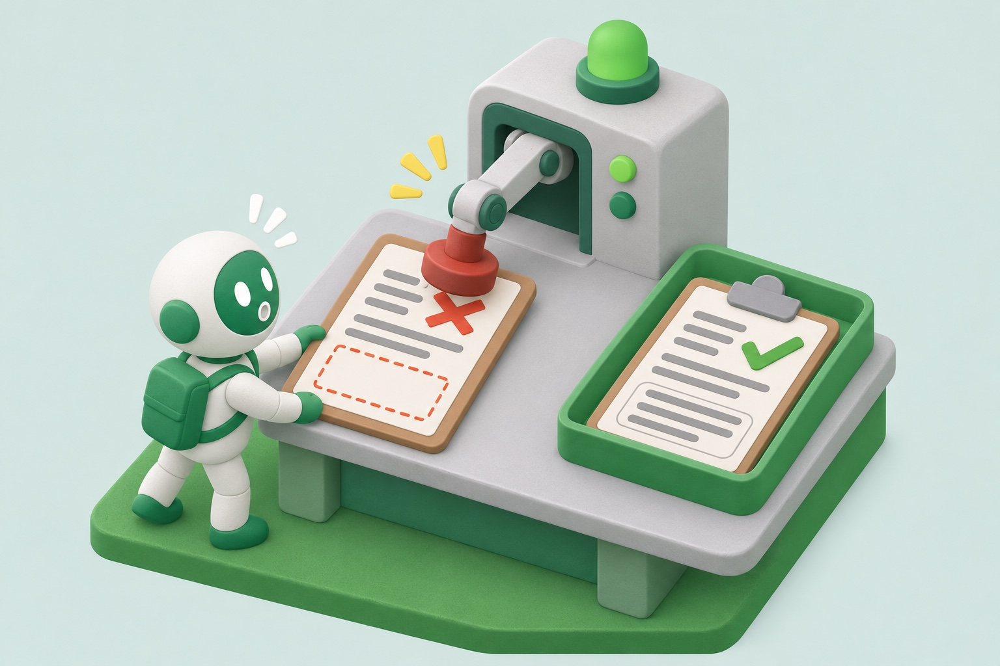

안녕하세요. 한국일보에서 AI와 백엔드 개발을 맡고 있는 현수입니다.

미스코리아 공식 홈페이지 개편 프로젝트에서 백엔드를 담당하며 Claude Code를 활용했습니다.

AI와 함께 개발하면서 가장 먼저 고민한 것은 AI가 프로젝트 규칙을 지키게 하는 방법이었습니다. Claude Code는 작업을 시작할 때 프로젝트 지침 파일인 `CLAUDE.md`를 읽습니다. 이 파일에 "`user` 모듈은 `admin` 모듈을 참조하지 않는다" 같은 규칙을 적어 두면 AI는 대부분 이를 따릅니다. 하지만 AI는 확률적으로 동작하기 때문에, 대화가 길어져 지침이 맥락에서 밀려나면 규칙과 다른 코드를 그럴듯하게 작성하기도 합니다.

그래서 AI에게 규칙을 알려 주는 데 그치지 않고, AI가 일하는 환경을 함께 설계했습니다. 지침 문서, 도구 실행 전후의 검사, 빌드처럼 AI의 작업을 둘러싼 환경을 하네스(harness)라고 부릅니다. **반드시 지켜야 하는 규칙은 문서에 적는 데서 그치지 않고, 규칙을 어기면 작업이 멈추는 장치로 만들었습니다.**


이 장치는 어느 레이어에 두느냐에 따라 막는 힘이 다릅니다. 위 그림의 표지판은 문서 규칙, 과속방지턱은 훅, 차단기는 검증, 철문은 빌드에 해당합니다. 검증은 AI가 만든 결과물을 받기 전에 형식을 검사하는 단계입니다.

| 레이어 | 막는 방식 | 이 글의 예 |
| --- | --- | --- |
| 빌드 (철문) | 규칙을 어긴 코드는 빌드에 실패합니다. | 모듈 간 의존 방향 |
| 훅 (과속방지턱) | AI가 도구를 실행하기 직전에 입력을 검사해 차단합니다. | 지정한 위치의 새 문서 생성 |
| 검증 (차단기) | AI가 제출한 보고서의 형식을 검사해 반려합니다. | 대조 보고서의 "못 본 것" 항목 |
| 문서 규칙 (표지판) | AI가 지침을 읽고 따를 때만 효과가 있습니다. | `CLAUDE.md`, 스킬 |

이번 글에서는 가장 강한 빌드부터 훅, 검증 순서로 각 레이어를 소개하고, 하네스로 막지 못한 문제와 한계를 함께 정리하겠습니다.

## 1. 빌드로 지킨 모듈 경계

### 세 모듈의 역할

미스코리아 홈페이지의 사용자는 크게 두 그룹으로 나뉩니다. 홈페이지를 이용하는 **방문자**와 콘텐츠를 관리하는 **운영자**입니다. 두 그룹은 같은 데이터를 다루지만 로그인 방식과 필요한 기능이 다릅니다.

이에 맞춰 백엔드 저장소를 Gradle 멀티모듈로 구성하고 세 개의 모듈로 나눴습니다.

| 모듈 | 사용 주체 | 담당 기능 |
| --- | --- | --- |
| `core` | `user`와 `admin`이 공통으로 사용합니다. | 두 모듈이 함께 쓰는 데이터 구조, DB 조회 코드, 보안 설정을 담습니다. |
| `user` | 홈페이지 방문자 | 방문자용 서비스 API를 제공합니다. |
| `admin` | 운영자 | 운영자용 관리 API를 제공합니다. |

모듈 간 의존은 아래 두 방향만 허용했습니다.

```text
user  ──┐
        ├──▶  core
admin ──┘

user ✕ admin : 서로 참조하지 않음
```

### 모듈을 나눈 이유

모듈을 나눈 가장 큰 이유는 AI와 함께 개발할 때 늘어나는 코드 충돌을 줄이기 위해서였습니다.

여러 개발자가 한 저장소에서 작업하면 코드 충돌은 언제든 생길 수 있습니다. 직접 코드를 작성할 때는 변경 속도가 느려서 충돌이 자주 일어나지 않았습니다. 하지만 AI와 함께 개발하면 한 사람이 하루에 수정하는 파일 수와 변경량이 크게 늘어납니다. 인원은 그대로인데 여러 사람이 같은 파일을 동시에 고칠 가능성이 높아지는 것입니다.

그래서 개발자별로 `user`와 `admin`을 나눠 맡고, 공통 코드는 `core`에 모았습니다. 각자 맡은 모듈 안에서 AI와 작업하면, 개발자 간 변경이 겹치는 범위는 `core`로 좁아집니다.

### 두 겹의 빌드 차단

이 의존 규칙은 `CLAUDE.md`에 적어 두는 데 그치지 않고 빌드에서 검사하도록 구성했습니다. AI가 규칙을 어기면 아래 두 단계 중 한 곳에서 빌드가 실패합니다.

| AI가 시도하는 방식 | 차단되는 단계 |
| --- | --- |
| 의존을 선언하지 않고 다른 모듈의 클래스를 참조 | 컴파일 단계에서 실패합니다. 상대 모듈이 클래스패스(컴파일러가 참조할 수 있는 코드 목록)에 없기 때문입니다. |
| `build.gradle`에 의존을 추가한 뒤 참조 | 모듈 간 의존 규칙을 테스트 코드로 검사하는 ArchUnit 테스트가 빌드 과정에서 실패합니다. |

컴파일 단계는 실수로 다른 모듈을 참조하는 경우를 막고, ArchUnit 테스트는 의존 선언까지 수정해 참조하는 경우를 막습니다. 덕분에 AI가 규칙을 기억하지 못하더라도, 규칙을 어긴 코드는 빌드를 통과할 수 없습니다.

## 2. 훅으로 지킨 작업 규칙

### 작업 흐름의 네 시점

모든 규칙을 빌드로 검사할 수는 없습니다. 예를 들어 "특정 폴더에 새 문서를 만들지 않는다"는 코드 구조가 아니라 AI의 작업 방식에 관한 규칙입니다. 이런 규칙에는 훅을 활용했습니다.

훅(hook)은 세션 시작, 도구 실행 전후처럼 정해진 시점에 Claude Code가 자동으로 실행하는 스크립트입니다. 훅을 저장소 설정에 등록하면 팀원 모두에게 같은 훅이 적용됩니다. 이번 프로젝트에서는 작업 흐름의 네 시점에 훅을 등록했습니다.

| 시점 | 역할 | 동작 |
| --- | --- | --- |
| 세션 시작 | 기준 문서와 코드를 맞춰야 한다는 규칙을 다시 안내합니다. | 안내 |
| 파일 생성 직전 | 지정한 위치에 새 문서를 만들지 못하게 합니다. | **차단** |
| 파일 수정 직후 | 수정한 경로에 따라 함께 맞춰야 할 문서를 AI에게 안내합니다. | 안내 |
| 커밋·푸시 직전 | 중요한 변경을 변경 이력 파일에 기록했는지 확인하도록 안내합니다. | 안내 |

네 개의 훅 중 세 개는 안내만 합니다. 안내 훅은 AI에게 규칙을 다시 상기시키는 역할이라, 결국 AI가 안내를 따라야 효과가 있습니다. 실제로 작업을 중단시키는 훅은 새 문서 생성을 막는 훅 하나입니다.

### 필요한 위치만 차단하기

새 문서 생성을 막는 훅을 만든 이유는 문서가 지나치게 늘어났기 때문입니다. AI는 문서를 빠르게 만들 수 있어서, `docs/` 아래에 쓰이지 않는 문서가 계속 쌓였습니다. 그래서 아래 세 위치에서만 새 파일 생성을 막았습니다.

| 차단한 위치 | 이유 |
| --- | --- |
| `docs/` 바로 아래 | 최상위 폴더를 정리된 상태로 유지합니다. |
| `docs/dev-docs/` 바로 아래 | 개발 문서는 주제별 하위 폴더에 두기로 했습니다. |
| `docs/dev-docs/core/` | Confluence 페이지와 1:1로 대응하는 정본 문서를 두는 위치입니다. |

하위 폴더 안의 파일 생성, 새 폴더 생성, 기존 파일 수정은 의도적으로 허용했습니다. 모든 경로를 막으면 AI와 사람 모두 우회 방법을 찾거나 문서 작성 자체를 피하기 때문입니다.

### 훅이 막을 수 있는 범위

이 훅은 Claude Code의 두 도구를 검사합니다. 파일을 작성하는 `Write`와 셸 명령을 실행하는 `Bash`입니다. 두 도구는 훅에 전달되는 정보가 달라서, 막을 수 있는 범위도 다릅니다.

`Write`로 파일을 만들 때는 생성할 파일 경로가 훅에 그대로 전달되므로 정확하게 차단할 수 있습니다. 반면 `Bash`로 파일을 만들 때는 명령 문자열만 전달되기 때문에, 훅이 정규식으로 경로를 찾아야 합니다. 이 방식으로는 아래와 같은 명령을 차단하지 못합니다.

- `bash gen.sh`, `python3 gen.py`: 스크립트 내부에서 만드는 파일 경로가 명령 문자열에 드러나지 않습니다.
- `D=docs; echo x > $D/a.md`: 셸이 변수를 치환한 뒤의 경로를 훅은 알 수 없습니다.
- `curl -o`, `tar -x`: 훅이 검사하는 파일 생성 명령 목록에 포함되지 않습니다.

스크립트 주석에도 이 한계를 "Bash 경로는 과속방지턱이지 완전한 차단이 아니다"라고 명시해 두었습니다.

실행 모드도 차단 범위에 영향을 줍니다. Claude Code의 auto mode는 도구 실행을 사람이 하나씩 승인하지 않는 모드입니다. 이 모드에서는 Claude Code가 파일을 수정할 때 `Write` 대신 `sed`나 heredoc 같은 셸 명령을 사용해도 된다고 안내합니다. 그러면 파일 생성이 정확하게 차단되는 `Write` 대신, 정규식 검사에 의존하는 `Bash`로 파일이 만들어집니다. 훅을 정확하게 구현하더라도 실행 모드에 따라 차단 범위가 달라지는 셈입니다.

## 3. 문서 규칙을 검사로 바꾼 사례

빌드나 훅으로 막기 어려운 규칙도 있습니다. 이런 규칙은 AI가 만든 결과물을 받기 전에 검사하는 방식으로 보완했습니다.

### 기준 문서 대조와 "못 본 것" 항목

AI는 근거가 없어도 그럴듯한 코드를 작성합니다. 그래서 무엇이 맞는지 판단할 기준 문서를 하나로 정했습니다. 이런 문서를 SSOT(Single Source of Truth)라고 부릅니다. 이번 프로젝트에서는 기획에서 Confluence로 관리하는 기능 정의 문서를 SSOT로 정하고, 기준이 한 방향으로만 흐르도록 했습니다.

```text
기획 문서(SSOT, 읽기 전용) → 개발 문서 → 코드
```

코드가 SSOT와 다르면 코드를 SSOT에 맞춰 수정합니다. 구현 편의를 위해 SSOT를 고치는 일은 허용하지 않았습니다.

처음에는 SSOT와 코드를 사람이 직접 대조했지만, 기억에 의존하다 보니 놓치는 부분이 생겼습니다. 그래서 대조 절차를 스킬로 만들었습니다. 스킬(skill)은 반복하는 작업 절차를 정리해 두고 AI가 필요할 때 불러 쓰도록 만든 지침입니다. 실제 대조는 메인 AI가 작업을 나눠 맡기는 서브에이전트(subagent) 두 종류가 나눠 맡습니다.

| 역할 | 모델 | 하는 일 |
| --- | --- | --- |
| 페이지 대조 | Sonnet | 기획 문서를 몇 페이지씩 맡아 개발 문서·코드와 다른 점을 사실만 나열합니다. 맞고 틀림은 판정하지 않습니다. |
| 누락 비평 | Opus | 대조 과정에서 놓친 부분만 지적합니다. 차이가 세 건 이상일 때만 호출합니다. |

분량이 많은 대조는 빠르고 비용이 낮은 Sonnet에, 판단이 필요한 비평은 더 정교하게 추론하는 Opus에 맡겼습니다.

남은 문제는 AI의 대조 결과를 얼마나 믿을 수 있느냐였습니다. 한번은 AI가 SSOT 안에서 서로 모순되는 부분 두 건을 보고했는데, 원문과 비교해 보니 두 건 모두 잘못된 판단이었습니다. 반대 방향의 오류는 더 찾기 어렵습니다. AI는 문서를 끝까지 확인하지 않고도 "차이 없음"이라고 보고할 수 있습니다. 보고서가 비어 있으면 실제로 차이가 없는지, 확인하지 않은 것인지 구분할 수 없습니다.

그래서 대조 보고서를 JSON 스키마로 검증하고, 검증을 통과한 보고서만 받도록 했습니다. 핵심은 `not_checked`(못 본 것) 항목입니다.



```json
"not_checked": {
  "type": "array",
  "minItems": 1
}
```

`minItems: 1`은 빈 배열을 허용하지 않는다는 뜻입니다. 따라서 AI는 아래 두 가지 중 하나를 반드시 작성해야 합니다.

- 확인하지 못한 항목 목록. 예: "첨부 파일 열기 실패", "하위 페이지 3개는 시간 제약으로 건너뜀"
- 모두 확인했다면 "전부 확인: <근거>"

시험 감독이 "모르는 문제는 빈칸으로 두지 말고 '모름'이라고 쓰세요"라고 안내하는 것과 비슷합니다. 빈칸을 허용하지 않으면 "다 확인했다"는 보고에도 근거가 필요해집니다.

AI가 이 스키마를 스스로 지키기를 기대하지는 않았습니다. 서브에이전트가 보고서를 JSON 파일로 저장하면, 메인 AI가 검증 스크립트로 모든 보고서를 스키마와 대조합니다. 검증에 실패한 보고서는 위반 내용을 붙여 해당 서브에이전트에게 한 번 다시 맡기고, 그래도 실패하면 최종 보고서에 "미검증"으로 표시합니다.

이 검증이 보고서 내용의 정확성까지 보장하지는 않습니다. 하지만 "꼼꼼히 확인하라"는 프롬프트 한 줄에 의존하던 규칙을, 형식을 지키지 않으면 반려되는 검사로 바꿀 수 있었습니다.

### 머지 알림의 발송 여부 판정

백엔드 변경 사항을 다른 직군에도 공유하기 위해, PR이 개발 브랜치에 머지되면 Microsoft Teams 팀 채팅에 알림 카드가 자동으로 올라가도록 구성했습니다. 카드의 변경 요약은 CI에서 Claude가 비개발자도 이해할 수 있는 문장으로 작성합니다.

하지만 문서나 테스트만 수정한 PR까지 알림을 보내면 중요한 알림이 묻힙니다. 그래서 변경된 파일이 모두 문서·테스트·빌드·CI 파일이면 카드를 보내지 않도록 했습니다.

이 판정은 모델을 호출하지 않고 경로 규칙(정규식)으로만 내립니다. "이 변경을 알릴 필요가 있는가"를 모델에 물으면 같은 PR이라도 답이 달라질 수 있기 때문입니다. 항상 같은 결과가 나와야 하는 판정은 확률적인 모델 대신 결정적인 규칙에 맡겼습니다.

## 4. 하네스로 막지 못한 문제

### 여러 벌로 나뉜 API 명세

API 명세는 springdoc으로 코드에서 자동 생성하고 있었습니다. 그런데 이와 별도로 API 문서가 여러 형태로 만들어지면서 같은 계약을 담은 문서가 여러 개로 늘어났습니다.

계약 하나를 바꿀 때마다 여러 문서를 직접 고쳐야 했고, 그 뒤에도 문서 간 불일치가 남았습니다. 어느 문서가 정본인지 정해 두지 않았던 것이 원인이었습니다.

### 도입했다가 되돌린 장치

이런 장치도 코드처럼 새로운 문제를 만들 수 있습니다. 실제로 도입했다가 되돌린 장치가 두 가지 있습니다.

- **PR 분할 규칙**: 큰 변경이 Teams 카드 한 장에 모이면 무엇이 바뀌었는지 파악하기 어려워, PR을 일정 크기 이하로 나누는 규칙을 도입했습니다. 하지만 나눈 PR 수만큼 알림도 늘어나 다음 날 규칙을 철회했습니다.
- **점검 체크포인트**: SSOT 점검에서 빠뜨리는 페이지가 없도록, 확인한 페이지에 "확인 완료" 표시를 남겼습니다. 그런데 표시를 갱신하는 시점이 한 번 어긋나자, 해당 페이지는 이후 점검에서 아무 경고 없이 계속 제외됐습니다. 지금은 점검 대상을 매번 사람이 정하고, 이번에 확인하지 않은 페이지 수를 보고서에 기록합니다. "본 것"을 기록해 건너뛰는 방식은 기록이 틀리면 누락을 숨깁니다. 3장의 `not_checked`처럼 "못 본 것"을 적게 해야 누락이 드러납니다.

### 구조로 막을 수 없는 것

한 기능의 지원 범위를 처음 확정한 뒤 SSOT에 맞춰 구현했는데, 이후 회의에서 범위를 다시 바꾸기로 결정했습니다. 코드는 새 결정에 맞춰 수정했지만, SSOT에는 처음 확정한 내용이 그대로 남아 있었습니다.

SSOT 대조를 실행하자 AI는 이 차이를 가장 심각한 불일치로 보고했습니다. 회의에 참석한 사람은 결정이 바뀐 사실을 알지만, 문서만 보는 AI는 알 방법이 없습니다. 회의에서 바뀐 결정은 빌드나 훅으로 막을 수 없습니다.

이번 회고를 준비하면서도 같은 문제를 겪었습니다. 1장의 모듈 분리 근거를 설계 문서에서 찾아보니 "분업"만 적혀 있었습니다. "AI가 변경량을 늘린다"는 판단도 실제로 했지만, 어디에도 기록하지 않았습니다.

## 마치며

이번 프로젝트에서 사용한 장치를 레이어별로 정리하면 다음과 같습니다.

- **빌드**: 의존 방향처럼 코드 구조로 표현할 수 있는 규칙에 적용합니다. 규칙을 어기면 빌드가 실패하므로 우회할 수 없지만, 코드로 표현할 수 있는 규칙에만 쓸 수 있습니다.
- **훅**: AI가 도구를 실행하기 직전에 입력을 검사합니다. 파일 경로가 그대로 전달되는 도구는 정확하게 차단할 수 있지만, 셸 명령은 정규식 검사에 의존하고 실행 모드의 영향도 받습니다.
- **검증**: AI가 제출한 결과물의 형식을 검사해, 빈 항목이나 근거 없는 "모두 확인" 보고를 반려합니다. 내용의 정확성까지 보장하지는 않습니다.
- **문서 규칙**: AI가 읽고 따를 때만 효과가 있습니다. 작업 방향을 안내하는 데 쓰고, 반드시 지켜야 하는 규칙은 위 레이어에서 검사합니다.

물론 모든 규칙을 하네스로 막을 수는 없습니다. 회의에서 바뀐 결정처럼 사람 사이의 합의로 정해지는 규칙은, 결정을 바로 기록하는 습관으로만 지킬 수 있습니다. AI와 함께 일하는 프로젝트일수록 기록이 없으면 AI는 오래된 문서를 기준으로 판단합니다.

이번 경험을 통해 AI에게 지키게 하고 싶은 규칙이 생기면, 어디에 적을지보다 어디서 막을지를 먼저 고민해야 한다는 점을 배웠습니다.
