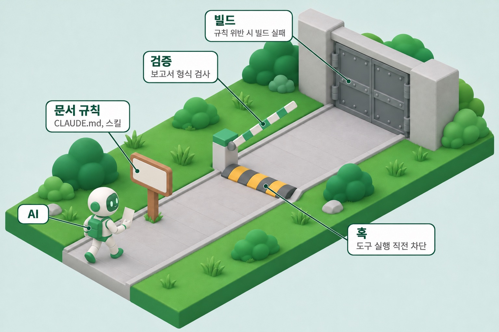

안녕하세요. 한국일보에서 AI와 백엔드 개발을 맡고 있는 현수입니다.

2026년 6월부터 9월까지 미스코리아 공식 홈페이지 개편의 백엔드를 만들었습니다. 유저가 보는 공개 사이트 API와 운영자가 쓰는 어드민 CMS를 한 저장소에서 만들었고, 백엔드 개발자는 두 명이었습니다. 개발 내내 Claude Code를 썼습니다.

이 글은 기능 소개가 아닙니다. AI와 같이 일하려고 개발 과정을 어떻게 바꿨는지, 그리고 그중 무엇이 깨졌는지에 대한 회고입니다. 도메인 로직과 프레임워크 사용법은 다루지 않습니다. 생산성 수치도 넣지 않았습니다. AI 없이 같은 일을 한 비교 대상이 없어서, 숫자를 내도 무엇과 비교한 값인지 말할 수 없기 때문입니다.

글에 자주 나오는 용어부터 정리합니다.

| 용어 | 이 글에서 뜻 |
| --- | --- |
| SSOT(Single Source of Truth) | "무엇이 맞는가"를 판단하는 단 하나의 기준 문서 |
| 훅(hook) | Claude Code가 세션 시작, 툴 실행 전후 같은 정해진 시점에 자동으로 실행하는 스크립트 |
| 스킬(skill) | 반복하는 절차를 묶어 두고, AI가 필요할 때 불러 쓰게 한 지침 |
| 서브에이전트(subagent) | 메인 AI가 일을 나눠 맡기는 별도 AI. 모델과 권한을 따로 정할 수 있습니다 |
| 하네스(harness) | 규칙·훅·스킬·서브에이전트를 저장소에 묶어 둔 것. 저장소에 있으니 팀원 누구에게나 똑같이 적용됩니다 |

## 먼저 나눈 모듈 경계

백엔드 두 명이 한 저장소에서 일하면 충돌은 원래부터 생길 수 있는 위험입니다. 손으로 코드를 짤 때는 변경 속도가 느려서 실제로는 잘 일어나지 않았습니다. AI와 함께 짜면 한 사람이 하루에 손대는 파일 수와 변경량이 크게 늘어납니다. 사람 수는 그대로인데 충돌 확률이 올라갑니다.

그래서 기능을 만들기 전에 저장소를 `core`(공통), `user`(유저 API), `admin`(어드민 CMS) 세 모듈로 나눴습니다. 의존은 `user → core`, `admin → core`만 허용하고, `user`와 `admin`은 서로 참조하지 못하게 했습니다.

이 금지는 문서에 적어 둔 규칙이 아닙니다. 두 겹으로 막혀 있어서 AI가 선을 넘으면 빌드가 깨집니다.

| AI가 시도하는 것 | 막히는 곳 |
| --- | --- |
| 의존 선언 없이 다른 모듈의 클래스를 참조 | 컴파일 실패. 상대 모듈이 클래스패스에 없습니다 |
| `build.gradle`에 의존을 추가한 뒤 참조 | 빌드 단계의 ArchUnit 테스트가 바이트코드를 검사해 실패시킵니다 |

ArchUnit은 패키지와 모듈 사이의 의존 규칙을 테스트 코드로 검사하는 Java 라이브러리입니다. 이렇게 빌드에서 막는 방식이 뒤에서 이야기할 "게이트 강도 순서"의 맨 윗단입니다.

## 판단 기준 하나, SSOT

AI는 근거가 없어도 그럴싸한 코드를 씁니다. "이게 맞나"를 물어볼 기준이 없으면 그럴싸한 구현이 그대로 굳습니다. 그래서 기획 쪽이 관리하는 Confluence 기능 정의 문서를 SSOT로 정했습니다.

| 항목 | 규칙 |
| --- | --- |
| 권한 | 읽기 전용. 백엔드는 이 문서를 고치지 않습니다 |
| 어긋날 때 | 우리 코드와 문서를 SSOT에 맞춥니다. 반대 방향은 금지입니다 |
| SSOT를 바꿔야 할 때 | 기획과 합의하고, 문서는 기획이 고칩니다 |

기준을 정하는 것만으로는 부족했습니다. 기준이 어느 방향으로 흐르는지도 못박았습니다.

```text
기획 문서(SSOT, 읽기 전용) → 개발 문서(docs/dev-docs/) → 코드
```

예외는 두 곳입니다. `docs/api/`의 API 명세는 코드에서 만든 문서라 기준이 SSOT가 아니라 지금 코드입니다. `docs/design/`은 초기 설계를 남긴 스냅샷이라 고치지 않습니다.

급할 때 구현에 맞춰 기준을 고치기 시작하면, 그 문서는 이미 기준이 아닙니다. 그래서 역방향을 금지 규칙으로 적었습니다.

### 나중에 덧붙인 대조 장치

처음에는 SSOT와 코드를 사람이 기억에 기대 대조했고, 그러다 놓쳤습니다. 그래서 대조를 스킬로 만들었습니다. 문서끼리만 보는 얕은 점검과 코드까지 보는 깊은 점검 두 가지가 있습니다. 개발 문서를 Confluence에 올리는 작업은 모두 "계획 제시 → 사람 승인 → 실행" 순서를 거칩니다.

깊은 점검은 서브에이전트 두 종류가 나눠 맡습니다.

| 역할 | 모델 | 하는 일 |
| --- | --- | --- |
| 페이지 대조 | Sonnet | 기획 페이지를 몇 개씩 맡아 우리 문서·코드와 다른 점을 사실로만 나열합니다. 판정은 하지 않습니다 |
| 누락 비평 | Opus | 대조가 무엇을 놓쳤는지만 지적합니다. 차이가 세 건 이상일 때만 부릅니다 |

이 장치를 만든 계기가 있습니다. 7월 30일, AI가 "SSOT 안에서 서로 모순되는 곳" 두 건을 보고했습니다. 원문과 대조해 보니 두 건 모두 오판이었습니다. 그 뒤로는 AI의 대조 결과 자체를 믿지 않고, 리포트가 스키마 검증을 통과해야 받아들입니다.

검증 스키마에서 가장 중요한 필드는 `not_checked`(못 본 것)입니다. 아래는 설명을 줄여 옮긴 것입니다.

```json
"not_checked": {
  "type": "array",
  "minItems": 1,
  "description": "못 본 것. 접근 실패·시간상 건너뛴 항목·판단 보류. 빈 배열 금지. 못 본 것이 없으면 \"전부 확인: <근거>\"를 명시적으로 써야 통과한다. 침묵을 적극적 주장으로 바꾸기 위한 장치다."
}
```

AI는 다 보지 않고도 "다 봤다"고 보고할 수 있습니다. 빈칸을 허용하지 않으면 AI는 못 본 것을 적거나, 다 봤다는 근거를 적어야 합니다. 같은 이유로 첨부 확인 결과와 하위 페이지 확인 결과도 빈 배열이면 반려합니다. 읽었다고 했는데 읽은 섹션 목록이 비어 있어도 반려합니다.

## 훅 네 개, 실제로 막는 건 하나

규칙을 `CLAUDE.md`에 적어 둬도 AI가 지키는지는 별개입니다. 그래서 작업 흐름의 네 시점에 훅을 걸었습니다.

| 시점 | 훅 | 하는 일 | 막는가 |
| --- | --- | --- | --- |
| 세션 시작 | `ssot-session-notice` | SSOT 전파 방향을 다시 알리고, 얕은 점검을 할지 사람에게 먼저 묻게 합니다 | 안내만 |
| 파일 생성 직전 | `block-new-docs` | 정해진 위치에 새 문서를 만드는 것을 막습니다 | **막음** |
| 파일 수정 직후 | `docs-sync-notice` | 고친 경로에 따라 무엇과 맞춰야 하는지 AI에게 알립니다 | 안내만 |
| 커밋·푸시 직전 | `git-precheck` | SSOT와 어긋나는지, 중요한 변경을 `AUDIT.md`에 적었는지 확인하게 합니다 | 안내만 |

등록은 `.claude/settings.json` 한 곳에서 합니다. 아래는 `statusMessage` 줄만 뺀 실제 설정입니다.

```json
{
  "hooks": {
    "PreToolUse": [
      {
        "matcher": "Bash",
        "hooks": [
          {
            "type": "command",
            "if": "Bash(git *)",
            "command": "bash \"$CLAUDE_PROJECT_DIR/.claude/hooks/git-precheck.sh\""
          }
        ]
      },
      {
        "matcher": "Write|Bash",
        "hooks": [
          { "type": "command", "command": "bash \"$CLAUDE_PROJECT_DIR/.claude/hooks/block-new-docs.sh\"" }
        ]
      }
    ],
    "PostToolUse": [
      {
        "matcher": "Edit|Write",
        "hooks": [
          { "type": "command", "command": "bash \"$CLAUDE_PROJECT_DIR/.claude/hooks/docs-sync-notice.sh\"" }
        ]
      }
    ],
    "SessionStart": [
      {
        "hooks": [
          { "type": "command", "command": "bash \"$CLAUDE_PROJECT_DIR/.claude/hooks/ssot-session-notice.sh\"" }
        ]
      }
    ]
  }
}
```

훅마다 작은 설계가 들어 있습니다.

- `ssot-session-notice`는 새 세션을 열 때와 `/clear` 뒤에만 실행됩니다. 컨텍스트 압축(compact)이나 세션 재개(resume) 때 다시 끼어들면 진행 중이던 작업 흐름이 끊기기 때문입니다.
- `docs-sync-notice`의 안내는 사용자 화면에 띄우지 않습니다. AI가 스스로 점검하는 용도라 매번 사람에게 알리거나 묻지 않습니다.
- `git-precheck`은 `AUDIT.md`가 30KB나 60항목을 넘으면 아카이브로 옮기라고 알립니다. 새 항목이 500바이트를 넘거나 번호와 이모지를 늘어놓은 에세이식이면 경고합니다.
- 네 훅 모두 `jq`가 없거나 입력 JSON을 읽지 못하면 오류를 조용히 넘기지 않고 경고를 남깁니다. 다만 작업은 막지 않습니다.

### 지켜야 할 자리만 차단

`block-new-docs`를 만든 이유는 문서가 너무 쉽게 늘어서입니다. AI가 문서를 싸게 만들어 주니 `docs/` 아래에 필요 없는 문서가 계속 쌓였습니다. 그래서 세 자리에서만 새 파일을 막았습니다.

| 막은 자리 | 이유 |
| --- | --- |
| `docs/` 바로 아래 | 루트를 정리된 상태로 유지합니다 |
| `docs/dev-docs/` 바로 아래 | 개발 문서는 하위 폴더에 두는 규칙이 있습니다 |
| `docs/dev-docs/core/` | Confluence 페이지와 1:1로 맞추는 정본 자리입니다 |

하위 폴더, 새 폴더, 이미 있는 파일 수정은 일부러 열어 두었습니다. 전부 막으면 우회하거나 아무도 안 쓰게 됩니다. 그래서 지켜야 할 자리만 막았습니다.

### 훅이 막을 수 있는 범위

`block-new-docs`는 `Write`와 `Bash` 두 툴을 검사합니다. 두 분기는 막는 힘이 다릅니다. 아래는 실제 스크립트를 줄여 옮긴 것입니다.

```bash
case "$tool" in
  Write)
    # 만들 파일 경로가 그대로 들어온다. 추측할 것이 없다
    reason=$(check_path "$(printf '%s' "$input" | jq -r '.tool_input.file_path')")
    ;;
  Bash)
    # 명령 문자열 하나뿐이다. 리다이렉트 대상 경로를 정규식으로 추측한다
    cmd=$(printf '%s' "$input" | jq -r '.tool_input.command')
    targets=$(printf '%s' "$cmd" | grep -oE ">>?[[:space:]]*$PATH_RE" | grep -oE "$PATH_RE")
    # tee·touch·cp·mv 같은 생성 명령이 있으면 명령 안의 docs/ 경로를 모두 검사한다
    ;;
esac

# 막을 이유가 있으면 deny를 돌려준다
[ -n "$reason" ] && jq -n --arg r "$reason" \
  '{hookSpecificOutput:{hookEventName:"PreToolUse",
    permissionDecision:"deny", permissionDecisionReason:$r}}'
```

`Write`로 파일을 만들면 훅은 만들 파일의 경로를 그대로 받습니다. 추측할 것이 없으니 확실히 막습니다. `Bash`로 만들면 훅이 받는 것은 명령 문자열 하나뿐입니다. 경로를 정규식으로 추측해야 해서 아래 경우는 빠져나갑니다.

- `bash gen.sh`, `python3 gen.py`: 스크립트 안에서 어떤 파일을 만드는지 보이지 않습니다.
- `D=docs; echo x > $D/a.md`: 셸이 변수를 펼친 뒤의 경로를 훅은 모릅니다.
- `curl -o`, `tar -x`: 생성 명령 목록에 없는 명령입니다.

스크립트 주석에도 이 한계를 적어 두었습니다. "Bash 경로는 과속방지턱이지 완전한 차단이 아니다."

여기에 실행 모드가 하나 더 얽힙니다. Claude Code의 auto mode를 켜면, Claude Code는 파일을 고칠 때 `Write`·`Edit` 대신 `sed`나 heredoc 같은 셸 명령을 써도 된다고 안내합니다. 그러면 파일 생성이 확실한 `Write` 분기를 타지 않고, 추측에 기대는 `Bash` 분기로 흐릅니다. 훅을 정확하게 짜도 실행 모드 하나가 게이트를 비켜 갈 수 있습니다.

## 머지 알림 하나가 만든 규칙

백엔드가 개발을 끝내도 다른 팀은 그 사실을 몰라 기다리곤 했습니다. 이 팀에는 PR 코드 리뷰 절차가 따로 없습니다.

그래서 PR이 `dev` 브랜치에 머지되면 Microsoft Teams 그룹 채팅에 카드가 자동으로 올라가게 했습니다. 카드 요약은 CI 안에서 `claude -p`가 비개발자도 읽을 수 있는 말로 씁니다. 이 자동화가 규칙 두 개를 더 만들었습니다.

1. **노이즈 변경은 무발송.** 바뀐 파일이 전부 문서·테스트·빌드·CI 파일이면 카드를 보내지 않습니다. 이 판정은 경로 규칙(정규식)이 내리고, 모델은 아예 호출하지 않습니다. 결과가 늘 같아야 하는 판정이라 모델에 맡기지 않았습니다.
2. **변경 공지문으로서의 PR.** `open-pr` 스킬은 PR 제목을 백엔드를 모르는 사람도 읽을 수 있게 쓰도록 강제합니다. 카드를 읽는 사람이 리뷰어가 아니라 프론트엔드 개발자와 기획자이기 때문입니다. PR이 리뷰 요청서에서 변경 공지문이 됐습니다.

## 만들었다가 버린 것 두 개

하네스도 코드처럼 회귀합니다. 만든 것 중 두 개는 버렸습니다.

### PR 분할 규칙: 8월 18일 도입, 8월 19일 철회

변경 하나가 크면 Teams 카드 한 장에 뭉쳐서 무엇이 바뀌었는지 가려졌습니다. 그래서 큰 변경을 500줄 단위의 PR 여러 개로 쪼개는 규칙을 넣었습니다. 다음 날 철회했습니다. 머지할 때마다 카드가 한 장씩 나가니, 쪼갠 만큼 팀 채팅방 알림이 늘었기 때문입니다.

### 점검 체크포인트: 8월 31일 폐기

SSOT 점검에서 페이지를 빠뜨리지 않으려고, 확인을 마친 페이지에 "확인 완료" 표시를 남겼습니다. 그런데 표시를 갱신하는 시점을 한 번만 잘못 잡아도, 그 페이지는 다음 회차부터 조용히 계속 건너뛰어졌습니다. 누락을 막으려고 만든 장치가 누락을 만들었습니다.

지금은 점검할 대상을 회차마다 사람이 정하고, 이번에 보지 않은 페이지 수를 보고서에 적습니다.

## 게이트의 강도 순서



만든 장치를 늘어놓고 보니, AI에게 규칙을 지키게 하는 수단은 막는 힘이 서로 달랐습니다. 위 그림으로 치면 표지판은 문서 규칙, 과속방지턱은 훅, 철문은 빌드입니다.

| 수단 | 막는 힘 | 이 프로젝트의 예 |
| --- | --- | --- |
| 컴파일·빌드 | 우회할 수 없습니다 | `user`↔`admin` 의존 금지 |
| 훅 | 툴 입력에 경로가 그대로 오면 확실히 막고, 셸 명령은 추측으로 막습니다 | `block-new-docs` |
| 문서 규칙 | AI가 읽어야 지킵니다. 컨텍스트에 실려 있을 때만 효력이 있습니다 | `CLAUDE.md`, 스킬 |

AI는 확률적으로 움직입니다. 확률적인 규칙으로는 확률적인 결과밖에 얻지 못합니다. 그래서 다음부터는 강제하고 싶은 규칙이 생기면 한 단계 위로 올릴 방법부터 찾으려 합니다. 문서 규칙보다 훅, 훅보다 빌드입니다.

## 깨진 전제: "문서 하나 = SSOT"

SSOT는 어떤 프로젝트에든 있어야 한다고 지금도 생각합니다. SSOT 없이 AI와 일하면 그럴싸한 구현이 그대로 굳습니다. 깨진 것은 "기획 문서 하나를 SSOT로 정하면 된다"는 전제였습니다.

### 문서에 남지 않는 구두 결정

| 날짜 | 일 |
| --- | --- |
| 6월 19일 | 기획 확정: 소셜 로그인은 카카오·네이버만 지원하고 구글은 뺍니다 |
| 6월 24일 | SSOT대로 코드에서 구글 로그인 연동을 걷어 냈습니다 |
| 8월 18일 | 구두 합의로 구글을 다시 넣었습니다. 코드와 DB 제약, 마이그레이션을 고쳤습니다 |
| 9월 | SSOT에는 여전히 카카오·네이버 두 가지만 적혀 있었습니다 |

SSOT 대조를 돌리자 AI는 이 차이를 가장 심각한 갭으로 보고했습니다. 사람은 "그거 회의에서 바뀐 거야"를 알지만, AI는 알 방법이 없습니다. AI는 문서만 봅니다. AI를 SSOT에 붙일수록 구두 합의의 비용이 커집니다.

### 여러 벌로 갈라진 API 명세

API 명세는 이미 springdoc으로 코드에서 자동 생성하고 있었습니다. 그런데 프론트엔드에 전달하는 문서가 따로 생기면서, 같은 계약을 담은 명세가 여러 벌이 됐습니다.

| 문서 | 크기 | 마지막 갱신 |
| --- | --- | --- |
| 어드민 API 목록 | 66KB | 8월 28일 |
| 어드민 프론트엔드 가이드 | 74KB | 8월 28일 |
| 어드민 OpenAPI 명세 | 110KB | 8월 21일 |
| 어드민 API 명세 엑셀 | 127KB | 7월 3일 |
| 유저 API 목록 | 74KB | 8월 28일 |

시각 표기를 UTC에서 KST로 바꾸는 계약 하나를 고치려고 문서 일곱 개를 손으로 고쳤습니다. 그래도 어긋남이 남았습니다. API 목록(8월 28일)이 자동 생성한 OpenAPI 명세(8월 21일)보다 최신이었고, 엑셀은 7월에 멈춰 있었습니다.

AI가 문서를 싸게 만들어 주니 문서 종류는 늘었는데, 관리 비용은 줄지 않았습니다. 더 큰 문제는 어느 것이 정본인지 우리가 알려 주지 않았다는 점입니다. 계약의 SSOT는 그 계약을 쓰는 사람이 실제로 읽는 문서여야 합니다. 아무도 읽지 않는 자동 생성물은 SSOT가 아닙니다.

### 변경 이력 파일과 `git log`의 중복

중요한 변경(DB 스키마, 보안, API 계약)은 `AUDIT.md`에 한 줄씩 남겼습니다. 커밋할 때마다 `git-precheck` 훅이 기록했는지 물었고, 이 기록은 프로젝트 끝까지 이어졌습니다.

같은 시기에 설계 문서(spec)와 구현 계획(plan)도 썼습니다. 7월 6일부터 8월 4일까지 약 한 달 동안 22개를 쓰고, 그 뒤로 끊겼습니다. 이 문서들은 `.gitignore`에 들어 있어 한 번도 커밋되지 않았습니다. 팀 입장에서는 존재하지 않는 문서였고, 확인하는 게이트도 없었습니다.

돌아보면 질문이 남습니다. 변경 이력은 `git log`에 이미 있고, 왜 그렇게 바꿨는지는 spec과 plan이 담을 수 있습니다. 요약 파일을 따로 유지하는 대신 `git log`와 작업 문서가 그대로 이력이 되게 했으면 어땠을까요. 다만 조건이 있습니다. spec과 plan도 커밋하고 게이트를 붙이지 않으면, 이번처럼 한 달 만에 사라집니다.

### 이 회고에도 빠진 기록

이 글의 첫 결정인 모듈 분리의 근거를 설계 문서에서 찾아봤습니다. 6월 17일에 확정한 설계 문서에 적힌 근거는 "2인 분업: 유저 개발자와 어드민 개발자가 서로 다른 모듈을 만진다"뿐이었습니다. AI 이야기는 한 줄도 없었습니다.

실제로는 "AI가 변경 속도를 올려 충돌 압력을 키운다"는 판단이 있었습니다. 그 판단만 기록되지 않았습니다. 회고를 준비하면서 구두로 정한 것이 남지 않는 문제를 직접 다시 겪은 셈입니다. 결정을 적어 두지 않으면, 그 결정을 내린 사람조차 몇 달 뒤에는 근거를 찾지 못합니다.

## 다음 프로젝트에서 처음부터 할 세 가지

1. **회의록의 SSOT 편입.** 구두 결정도 기록 대상으로 다룹니다. 결정만 따로 로그로 남기고, 기획 문서에도 커밋 메시지처럼 변경 의도를 함께 적습니다. AI가 붙는 프로젝트일수록 필요합니다.
2. **소비자 기준의 계약 SSOT.** Swagger를 설치해 두는 것으로 끝내지 않고, 프론트엔드가 실제로 읽게 만듭니다. 정본을 하나만 남기고, 그것이 정본이라고 밝힙니다. 같은 서비스라면 프론트엔드와 백엔드 저장소를 합치는 것도 방법입니다. 같은 저장소에 있으면 프론트엔드가 생성된 타입을 `import`하게 되니 안 볼 수가 없습니다.
3. **강제할 규칙은 한 단계 위로.** 문서 규칙보다 훅, 훅보다 빌드로 막습니다. 훅으로 못 막는 것은 구조로 막고, spec과 plan도 커밋하고 게이트를 붙입니다.

세 가지를 한 줄로 줄이면 이렇습니다. SSOT는 문서가 아니라, 합의를 기록하는 습관입니다.
