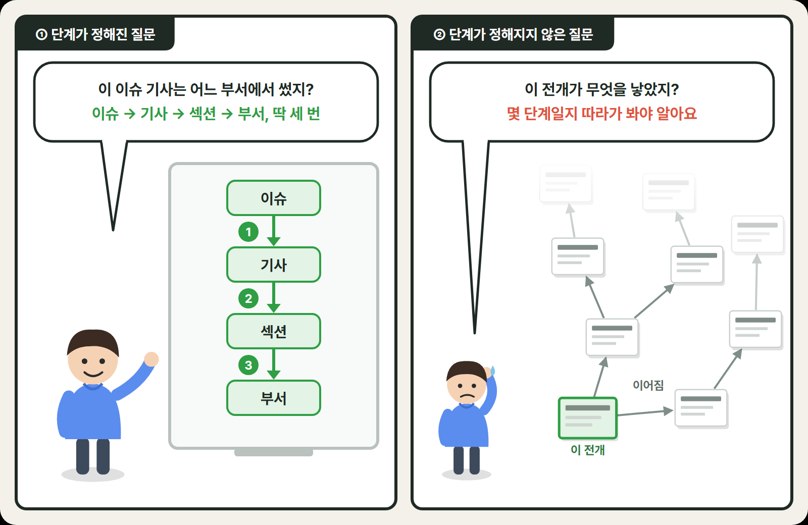
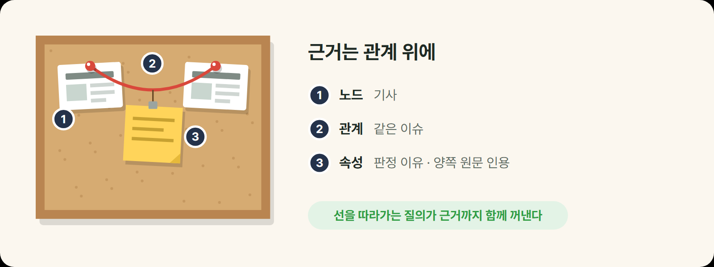
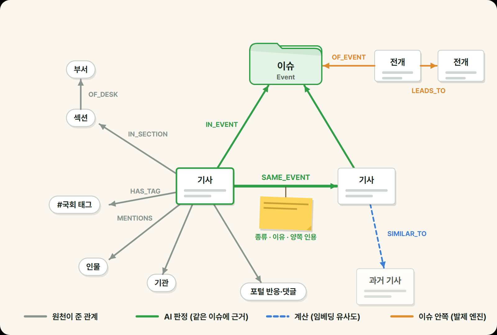
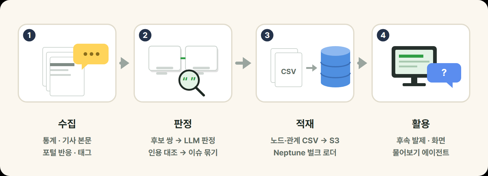
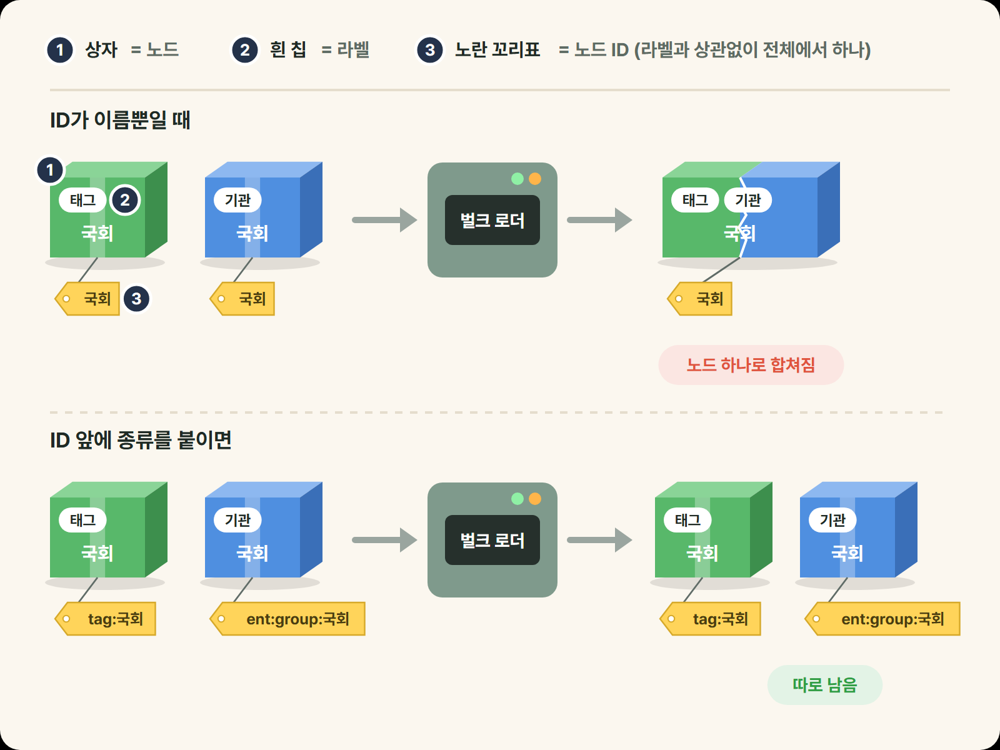

안녕하세요. 한국일보에서 클라우드를 담당하고 있는 찬욱입니다.

한국일보에는 매일 쓰는 기사와 함께 조회 통계 같은 데이터가 쌓입니다. 하지만 이 데이터는 대부분 기사 한 건 단위로만 쓰였고, 기사와 기사 사이의 관계는 어디에도 남지 않았습니다. 쌓인 기사 데이터를 더 활용할 방법은 없을까, 그 관계를 그래프 DB에 담아 쓸 수는 없을까 고민하다 시작한 것이 사내 개념 검증(PoC) 프로젝트 N.C.I(New Context Insights)입니다.

N.C.I는 기사가 어느 이슈에 묶이는지 AI가 판정해 이슈 흐름을 파악하고, **그 흐름을 바탕으로 편집회의에 올릴 후속 발제를 제안하는 도구**였습니다. N.C.I의 바탕에는 기사 사이의 관계와 근거를 쌓은 그래프가 있었고, 저는 N.C.I에서 온톨로지 설계와 그래프 DB 구축을 맡았습니다.

이번 글에서는 N.C.I를 만들며 어떤 문제가 있었고, 이를 풀기 위해 그래프 DB와 온톨로지를 어떻게 도입했는지, 그 위에서 무엇이 가능해졌고 어떤 시행착오를 겪었는지 소개하겠습니다.

## 1. 기사 데이터로 답하기 어려웠던 질문

N.C.I의 사용자는 아침 편집회의를 준비하는 부서 데스크였습니다. 후속을 제안하려면 먼저 어떤 기사들이 같은 이슈이고, 그 안에서 무엇이 새로 확인됐고 무엇이 아직 확인되지 않았는지 알아야 했습니다.

하지만 기사 데이터는 제목, 날짜, 조회수 같은 항목으로만 저장돼 있어서, "두 기사가 같은 이슈다"처럼 기사 사이의 관계를 적을 항목이 없었습니다. 관계는 따로 저장해 두고, 찾을 때마다 기사 데이터와 대조해야 했습니다.

이 대조를 여러 번 거쳐야 답이 나오는 질문도 있었습니다. 이슈의 기사가 어느 부서에서 나왔는지는 이슈에서 기사, 섹션을 거쳐 부서까지 매번 같은 세 단계입니다. 하지만 한 사건이 몇 단계의 사슬을 거쳐 다음 사건과 이어지는지는 그래프를 탐색해 봐야 알 수 있습니다. 예를 들어 같은 이슈 안에서 어떤 발표가 다음 결정으로, 그 결정이 다시 다른 조치로 이어지기도 합니다. 이런 질문은 몇 번 대조해야 할지 미리 알 수 없어서, 언제 멈출지까지 직접 정해 줘야 했습니다.



또 N.C.I 화면은 미리 정해 둔 질문에만 답해서, 한 부서의 기사를 시간대별로 세어 달라는 것처럼 데스크가 그때그때 떠올린 질문에는 답할 수 없었습니다.

## 2. 그래프 DB와 온톨로지

### 그래프 DB와 Neptune

기사 사이의 관계를 따라가야 답이 나오는 질문에 답하려고, 연결 자체를 데이터로 담는 그래프 DB를 쓰기로 했습니다. 그래프 DB는 형사 드라마에 나오는 사건 보드와 비슷합니다. 형사는 용의자, 피해자, 장소를 카드 한 장에 하나씩 적어 보드에 붙이고, 서로 관련 있는 카드끼리 실로 잇습니다. 실에는 "사건 당일 통화"처럼 왜 이었는지를 메모로 붙입니다. 그러면 실을 따라가며 누가 누구와 어떻게 얽혀 있는지 볼 수 있습니다.

그래프 DB에서는 카드처럼 하나하나의 대상을 노드, 두 대상을 잇는 실을 관계, 카드나 실에 붙인 메모를 속성이라고 합니다.

N.C.I의 보드에서는 기사와 인물·기관, 이슈가 노드입니다. 두 기사를 잇는 "같은 이슈" 실과 기사에서 인물로 이어지는 "언급" 실이 관계이고, "같은 이슈" 실에는 왜 같은 이슈로 봤는지 판정 이유와 양쪽 원문 인용을 메모로 붙였습니다. 형사가 실을 따라가듯, 몇 단계를 건너는 질문도 실을 따라 노드에서 노드로 넘어가면 되므로 단계가 몇 개인지 미리 정하지 않고 물을 수 있습니다.



그래프 DB로는 AWS의 Amazon Neptune을 사용했습니다. Neptune을 쓴 이유는 **물어보기 기능** 때문이었습니다. 신문사에서는 기사를 배정하고 검토하는 부장을 데스크라고 부르는데, 이 데스크들이 화면에 없는 질문을 AI 에이전트에게 바로 던질 수 있어야 했습니다. 화면에 보여 줄 숫자는 하루 한 번 계산해 두면 됐지만, 데스크가 물어볼 때마다 에이전트가 그래프에 질의하려면 그래프 DB가 늘 켜져 있어야 했습니다.

### 온톨로지

온톨로지는 한 분야의 개념과 그 사이의 관계를 정해 둔 것으로, 사람과 프로그램이 같은 말을 같은 뜻으로 쓰게 하는 것이 목적입니다. 사건 보드에 빗대면 어떤 종류의 카드와 실을 쓰고 각각이 무엇을 뜻하는지 적어 둔 목록입니다. N.C.I의 온톨로지에는 기사, 이슈, 인물·기관, 부서 같은 노드의 종류와 "같은 이슈", "이어진 사안", "언급" 같은 관계의 종류, 그리고 각각의 뜻이 들어갔습니다.

뜻을 정해 두지 않으면 "같은 이슈"라는 말부터 흔들립니다. 두 기사에 "국회" 같은 이름이 함께 나오기만 해도 같은 이슈로 볼 수도 있고, 내용을 읽고 같은 사안인지 따져 본 뒤에야 같은 이슈로 볼 수도 있습니다. 같은 이름이 나와도 실제로 같은 이슈인 경우는 생각보다 적어서, N.C.I는 AI가 두 기사를 읽고 같은 사안이라고 판정한 관계만 "같은 이슈"로 정했습니다. 이름이 겹치는지는 AI에게 비교를 맡길 기사 짝을 고르는 데만 썼습니다.

그런데 Neptune 같은 그래프 DB는 이렇게 정해 둔 카드와 실의 종류를 지켜 주지 않습니다. 항목으로 저장하는 DB는 어떤 항목을 둘지 먼저 정해야 값을 넣을 수 있어서, 틀에 맞지 않는 값은 들어가지 않습니다. 반면 Neptune은 그런 틀 없이 처음 보는 종류의 카드와 실도 그대로 받아 줍니다. 그래서 정해 둔 종류와 뜻을 지키는 일은 DB가 아니라 데이터를 싣는 쪽과 꺼내 쓰는 쪽이 맡아야 했습니다. 특히 그때그때 스스로 질의를 짜는 물어보기 에이전트는 이 뜻을 알아야 해서, 온톨로지를 문서로 정리해 질의 전에 먼저 읽게 했습니다.

<details class="mt-20 rounded-8 border border-line bg-surface px-16 py-12 text-15 [&>p]:mt-8">
<summary class="cursor-pointer font-semibold text-foreground">N.C.I 온톨로지 예시</summary>

에이전트가 읽는 온톨로지 문서의 일부를 줄여 옮기면 이렇습니다. 정해진 표준 형식은 아닙니다. LLM이 질의를 짤 수 있게 노드·관계 종류와 연결 모양을 알려 주는 스키마 설명에, 사람이 적은 뜻과 주의 사항을 더한 것입니다. 실제 문서에는 노드와 관계마다 개수, 부서 목록, 수집 기간도 함께 들어 있습니다.

```text
노드  Article(기사) · Event(이슈) · Entity(인물·기관·사건명) · Tag · Section · Desk
      Development(전개) · Open(미확인 사항) · Pitch(발제) …

관계  (Article)-[:SAME_EVENT]->(Article)   AI가 판정한 같은 이슈
      (Article)-[:IN_EVENT]->(Event)       기사가 속한 이슈
      (Article)-[:MENTIONS]->(Entity)      기사가 언급한 인물·기관
      (Article)-[:SIMILAR_TO]->(Article)   본문이 비슷한 기사(계산)
      (Event)-[:CONTINUES]->(Event)        ID가 바뀐 이슈의 옛 이슈 → 새 이슈 …

주의  - 이슈는 Event 노드다. 이슈의 기사는 IN_EVENT로 묻고, 태그로 뭉치지 마라.
      - SIMILAR_TO는 "비슷하다"이지 "같은 이슈"가 아니다. 이걸로 이슈를 묶지 마라.
      - Event의 이름은 모델이 지은 것이다. 사실로 인용하지 말고 모델이 붙인 이름이라고 밝혀라.
      - Batch·Section은 그날 기사 전부와 이어진다. 이걸 거쳐 관련 기사를 뽑지 마라.
      - 기자 정보는 묻지 마라.
```

</details>

정한 뜻은 사람이 함께 보는 용어집에도 남겨, 한 뜻에 한 단어만 쓰고 "이렇게 부르지 말 것"도 적었습니다. 예를 들어 전개는 "한 이슈 안에서 보도로 확인되는 새 발표·결정·진행"이고, 기사 한 편이나 이슈 전체는 전개라고 부르지 않습니다.

## 3. 온톨로지 설계와 그래프 구축

### 질문에서 시작한 설계

온톨로지 설계는 질문에서 시작했습니다. 원천 데이터의 모양을 그대로 옮기면 기사 사이의 관계는 빠진 채 항목만 노드와 속성이 되어, 정작 화면이 답해야 할 질문에는 답하지 못합니다. 질문 목록을 먼저 세우고, 온톨로지를 바꿀 때마다 이 목록으로 채점했습니다. 회의 브리핑에 쓰는 문항 가운데 하나라도 답하지 못하게 되면 변경을 되돌렸습니다. 문항마다 결과는 네 가지로 매겼습니다.

| 결과 | 뜻 | 쓰임 |
| --- | --- | --- |
| 답한다 | 지금 그래프와 화면이 답한다 | 고칠 때마다 계속 답하는지 확인 |
| 그래프만 답한다 | 질의로는 답이 나오지만 화면이 없다 | 물어보기가 맡을 질문 |
| 온톨로지가 못 담는다 | 재료는 있는데 지금 설계로는 못 담는다 | 온톨로지를 고칠 이유 |
| 답하면 안 된다 | 원천이 부족하거나 정책상 금지다 | "답할 수 없다"가 정답 |

### 원천이 준 관계와 만든 관계

관계를 정할 때 첫 원칙은 "원천 데이터가 주지 않은 구조는 만들지 않는다"였습니다. 그래프에는 원천이 확인해 준 사실만 두고, 판단은 사람에게 맡기려는 것이었습니다. 하지만 N.C.I의 중심인 "두 기사가 같은 이슈인가"는 원천이 알려 주지 않습니다. 그래서 원천 밖에서 만든 관계는 예외로 허용하고, 만든 방법을 `source` 속성으로 표시해 질의에서 신뢰도를 구분할 수 있게 했습니다.



같은 사안을 다루는 두 기사는 "같은 이슈" 관계로 잇고, 이 관계를 따라 이어지는 기사들만 하나의 이슈로 묶었습니다. 묶는 계산은 그래프 밖에서 하고 결과만 실었습니다. 다른 사안이지만 앞 사안에서 비롯된 기사는 "이어진 사안" 관계로 잇되, 이 관계로는 이슈를 묶지 않았습니다. 예를 들어 태풍 피해 기사와 피해 복구 예산 기사는 서로 다른 이슈이고, 복구 예산은 태풍 피해에서 비롯된 사안입니다. 이런 "이어진 사안"까지 "같은 이슈"로 이으면 A와 B, B와 C, C와 D가 차례로 이어지다가 서로 상관없는 A와 D까지 한 이슈가 됩니다.

이 가운데 온톨로지의 중심은 "같은 이슈" 관계인 `SAME_EVENT`입니다. 관계 위에는 세부 종류(후속·반응·배경·다른 각도), 판정 이유 한 문장, 짧은 요지, 양쪽 원문 인용, 판정한 AI 모델을 함께 실었고, 방향은 먼저 나온 기사에서 나중 기사로 뒀습니다.

### 그래프 구축

이렇게 설계한 그래프는 하루 한 번 자동으로 도는 작업으로 Neptune에 실었습니다. 통계가 하루 한 번 들어오기 때문입니다.



1. **수집:** 통계, 기사 본문, 포털 반응, 자사 태그를 모았습니다. 포털 반응은 원문 주소가 일치할 때만 기사와 짝지었고, 제목이 비슷하다고 붙이지 않았습니다.
2. **판정:** 비교할 기사 짝을 먼저 추린 뒤, LLM이 두 기사를 읽고 같은 이슈, 이어진 사안, 무관 중 하나로 판정하면서 양쪽 기사에서 근거 문장을 하나씩 뽑았습니다. 뽑은 문장이 원문에 그대로 있는지 대조한 다음, 같은 이슈로 판정된 기사끼리 이슈로 묶었습니다. 그리고 이슈별로 한 번 더 확인해, 관련만 있을 뿐 다른 이슈인 기사를 떼어 냈습니다.
3. **적재:** 수집한 데이터와 판정 결과 전체를 노드·관계 CSV로 바꿔 S3에 올리면, Neptune 벌크 로더가 통째로 읽어 실었습니다. 오류가 하나라도 나면 적재 전체를 실패로 돌려, 일부만 실린 그래프가 남지 않게 했습니다.
4. **활용:** 후속 발제를 만드는 단계, 화면 파일을 만드는 단계, 물어보기 에이전트가 이 그래프를 읽었습니다.

## 4. 그래프 위에서 가능해진 것

- **후속 발제 제안:** 후속 발제를 만드는 단계가 그래프에서 이슈와 "같은 이슈" 관계를 읽고, LLM으로 이슈마다 후속 발제 후보와 초안을 만들었습니다. 후보에는 요약, 확인할 곳, 마감, 왜 지금 다뤄야 하는지가 들어갔습니다. 이슈에서 새로 확인된 것은 전개로, 아직 확인되지 않은 것은 미확인 사항으로 나눠 발제와 함께 그래프의 이슈 아래에 다시 실었습니다. 앞 전개와 뒤 전개, 발제와 미확인 사항을 각각 잇는 관계도 함께 남겼습니다.
- **이슈 흐름:** 날짜가 바뀌어도 어제의 이슈와 오늘의 같은 이슈를 하나로 다뤄, 그 이슈가 며칠째 보도되고 있는지와 기사가 평소보다 늘고 있는지를 화면에서 바로 볼 수 있었습니다.
- **근거 보기:** 이슈 상세의 관계 지도에서 선마다 세부 종류와 요지를 달아, 두 기사가 왜 이어졌는지 선만 보고도 알 수 있었습니다.

### 후속 발제 예시

DMZ 지뢰 폭발 사고 이슈를 예로 들면 이렇습니다. 9월 21일 첫 보도 뒤 이 이슈에는 여러 기사가 묶였고, 그 안에서 확인된 전개와 아직 답이 나오지 않은 미확인 사항이 쌓였습니다. 10월 7일 회의를 앞두고 N.C.I는 「수색로 개척 때 안전대책 있었나」라는 후속 발제를 제안했습니다. 발제에 적힌 확인할 곳은 합동참모본부와 국방부였습니다. 왜 지금 다뤄야 하는지에는 9월 21일과 26일 자사 보도로 제기된 수색로 안전대책 의혹이 10월 1일 보도 이후 엿새째 멈춰 있다는 점이 들어갔습니다.

데스크가 이 발제를 회의에 올릴지 판단하려면 무엇을 근거로 나왔는지부터 봐야 합니다. 그래프에서는 발제에서 출발해 실을 거꾸로 따라가면 됩니다. 이 발제는 「수색로 개척 때 지뢰 탐지 조치는 있었나?」라는 미확인 사항에서 나왔고, 이 사항은 9월 21일 사고 전개와 이어져 있었습니다. 이 사항이 처음 나온 기사로 가는 관계에는 그 문장도 실려 있어, 발제에서 근거 기사까지 질의 한 번으로 거슬러 올라갈 수 있었습니다. 발제를 채택할지는 근거를 본 데스크가 정했습니다.

```text
발제              수색로 개척 때 안전대책 있었나 (10월 7일 회의)
└ 미확인 사항     수색로 개척 때 지뢰 탐지 조치는 있었나? (확인할 곳: 합참 관계자)
   ├ 전개         DMZ 수색 작전 중 지뢰 추정 폭발로 간부 3명 부상 (9월 21일)
   └ 근거 기사    9월 21일 기사와 이 사항이 나온 문장
```

### 물어보기 예시

물어보기에서는 발제 하나를 골라 이렇게 근거 기사까지 거슬러 올라갈 수 있었습니다. 전개끼리 잇는 관계를 끝까지 따라가, 한 이슈 안에서 어떤 발표가 어떤 결정으로 이어지고 그 결정이 다시 어떤 조치로 이어졌는지를 단계 수를 정해 두지 않고 보여 주기도 했습니다.

물어보기 에이전트에는 부서 통계처럼 미리 정한 질문에 답하는 고정 도구 외에, 그래프를 직접 살펴보는 도구 두 개를 더 줬습니다. `graph_schema`로는 온톨로지 문서를 읽고, `graph_query`로는 질의를 실행합니다. 초기 시험 대화에서는 고정 도구로 답할 질문, 그래프에 직접 물어야 할 질문, 답하면 안 되는 질문이 이렇게 갈렸습니다.

```text
데스크: 정치부는 어제 전체적으로 어땠어?
  → 고정 도구(부서 통계)로 답했다
데스크: 정치부 기사, 시간대별로 그래프에서 직접 세어 줘
  → 고정 도구에 없는 질문. 온톨로지 문서를 먼저 읽고 질의를 직접 짰다
데스크: 방금 본 기사, 누가 썼어?
  → 도구 없이 거절했다. 당시엔 기자 정보를 정책상 막았다
```

두 번째 질문에서 에이전트는 먼저 온톨로지 문서에서 노드와 관계의 종류, 부서와 수집 회차 목록, 주의 사항을 읽고, 그래프용 질의 언어인 openCypher로 이런 모양의 질의를 짜서 그래프에 물었습니다.

```cypher
MATCH (b:Batch {id: $batch})<-[:COLLECTED_IN]-(a:Article)
      -[:IN_SECTION]->(:Section)-[:OF_DESK]->(d:Desk {name: $desk})
RETURN a.publishedHour AS hour, count(a) AS articles
ORDER BY hour
```

이번 회차에 모은 기사 가운데 이 부서가 맡은 섹션의 기사를 나간 시각별로 세어 달라는 질의입니다.

<details class="mt-20 rounded-8 border border-line bg-surface px-16 py-12 text-15 [&>p]:mt-8">
<summary class="cursor-pointer font-semibold text-foreground">openCypher 읽는 법</summary>

openCypher는 Neo4j가 만든 그래프 질의 언어 Cypher를 여러 DB가 쓸 수 있게 공개한 사양입니다. SQL이 표에서 행을 고른다면, openCypher는 찾고 싶은 그래프 모양을 그려서 그 모양과 맞는 부분을 찾습니다.

괄호는 노드, 대괄호는 관계, 화살표는 방향입니다. 위 질의에서 `(b:Batch {id: $batch})`는 종류가 Batch이고 id가 $batch인 노드, `<-[:COLLECTED_IN]-`는 기사에서 수집 회차로 가는 관계를 뜻합니다. `RETURN`은 SQL의 SELECT처럼 꺼낼 값을 고릅니다.

</details>

에이전트가 짠 질의는 화면에 쓰는 질의와 같은 검사를 통과해야 실행됐습니다. 검사는 그래프를 읽기만 하는 질의 한 문장만 받고, 기자를 거쳐 가는 질의를 막고, 돌려주는 결과 수에 상한을 두었습니다. 검사에 걸리면 오류 대신 걸린 이유를 돌려줘서, 에이전트가 그 이유를 보고 질의를 다시 짤 수 있게 했습니다.

## 5. 시행착오와 남은 한계

### 불필요한 노드와 문서 누락

조회수 같은 기사 성과 수치는 처음에 기사 노드와 별도의 노드로 만들었습니다. 그런데 성과는 기사 하나에만 딸린 값이라 다른 기사와 함께 쓸 일이 없었고, 성과에서 출발하는 질문도 없었습니다. 오히려 성과를 꺼낼 때마다 기사에서 성과 노드로 한 번 더 건너가야 해서 질의만 한 단계 길어졌습니다. 성과를 기사 노드의 속성으로 옮겼고, 옮긴 뒤에도 화면 결과는 이전과 같았습니다.

에이전트가 읽는 온톨로지 문서가 그래프와 어긋난 적도 있습니다. 문서에서 이슈라는 노드 종류가 빠지자 에이전트가 이슈 묶음이 있는데도 없다고 답했습니다. 그 뒤로는 자동 검사를 두었습니다. 그래프에 싣는 코드의 노드·관계 목록과 문서에 적힌 목록을 비교해, 싣기는 하는데 문서에 없는 종류가 있으면 그 이름을 알려 주며 실패합니다.

### ID 충돌과 끊김

Neptune에서 노드 ID는 종류와 상관없이 그래프 전체에서 하나뿐이어야 하는데, 이름을 그대로 ID로 썼습니다. 그러자 태그 '국회'와 기관 '국회'가 노드 하나로 합쳐져, '국회' 태그가 붙은 기사와 기관 '국회'를 언급한 기사를 나눠 물을 수 없었습니다. 그래서 ID 앞에 `tag:국회`, `ent:group:국회`처럼 노드 종류를 붙였습니다.



이슈 ID는 처음에 이슈에 속한 기사 목록으로 만들었습니다. 그러면 기사가 하나만 새로 붙어도 ID가 바뀌어, 어제와 오늘 이어지는 같은 이슈가 서로 다른 이슈로 보였습니다. 그 뒤로는 어제 이슈와 기사가 절반 이상 겹치면 그 ID를 이어받게 했습니다.

에이전트가 언제든 그래프에 물을 수 있어야 했지만, 처음엔 매일 전부 비우고 다시 싣느라 그동안 그래프가 비어 있었습니다. 벌크 로더가 이미 있는 ID의 값을 기본적으로 덮어쓰지 않기 때문입니다. 덮어쓰기 옵션도 같은 관계가 매일 같은 ID를 받아야 제대로 덮어쓰는데, 목록의 순번으로 지은 관계 ID는 목록이 바뀌면 같은 관계에도 다른 번호가 붙었습니다. 그래서 관계 ID를 양 끝 노드와 관계 종류로 짓고 덮어쓰기 옵션을 켜, 그래프를 비우지 않고도 바뀐 값만 고치도록 했습니다.

### 남은 한계

같은 사안이 처음부터 두 이슈로 따로 묶인 경우는 아직 풀지 못했습니다. ID를 이어받는 방식으로는 둘이 이어지지 않아, 닮은 이슈를 후보로만 보여 주고 자동으로 합치지는 않았습니다. 인용을 원문과 대조하는 것도 문장이 원문에 있다는 것까지만 보장하고, 판정이 옳은지는 보장하지 못합니다.

## 마치며

그래프 DB와 온톨로지를 직접 설계하고 운영하며 정리한 내용입니다.

- **그래프 DB가 필요한 곳:** 화면에 띄우는 집계는 그래프 DB 없이도 충분했습니다. 그래프 DB는 연결과 그 근거를 함께 남겨야 할 때, 하루하루 이어지는 사건의 흐름을 따라가야 할 때, AI 에이전트가 그래프 구조를 읽고 스스로 질의를 짜게 할 때 쓸모가 컸습니다.
- **온톨로지의 역할:** 틀을 강제하지 않는 그래프 DB에서는 어떤 노드와 관계를 쓰고 각각이 무엇을 뜻하는지 따로 정해야 합니다. 정한 뜻은 문서로 남기고, 실제 데이터와 어긋나지 않는지 검사로 맞춰 두어야 했습니다.

이 글을 통해 그래프 모델을 처음 접하고 설계하신다면, 모델을 그리기 전에 답해야 할 질문을 적어 보는 것을 출발점으로 삼으시길 권해드립니다.
