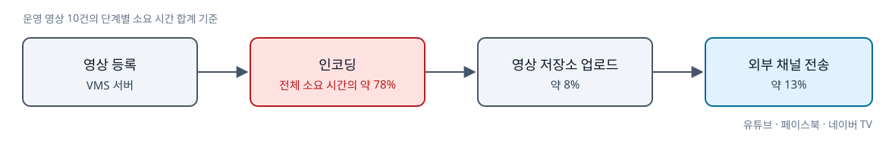
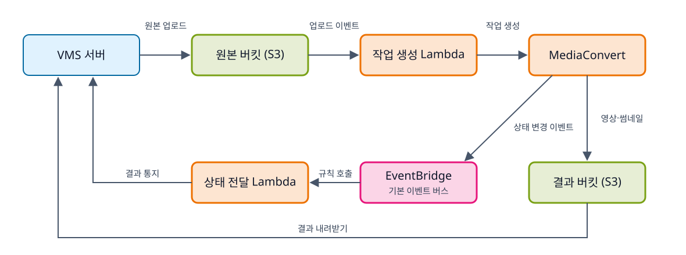

안녕하세요. 한국일보에서 기사작성시스템인 CMS 백엔드개발을 담당하고 있는 김유정입니다.

한국일보에는 VMS(Video Management System)라는 영상 관리 시스템이 있습니다. 기사 본문에 넣을 영상과 홈페이지에 노출할 영상은 모두 VMS에 등록합니다. VMS는 등록된 영상을 한국일보 홈페이지뿐 아니라 유튜브, 네이버 TV, 페이스북 같은 외부 채널로도 전송합니다.

VMS는 필요한 영상만 전송 전에 인코딩하는데요, 여기서 인코딩은 영상 앞뒤에 한국일보 인트로와 아웃트로를 붙이고 화면 구석에 로고 워터마크를 넣는 작업입니다. 이 세 가지는 영상마다 사용 여부를 정할 수 있고, 하나도 사용하지 않는 영상은 인코딩 없이 바로 전송됩니다.

이번에 저희는 인코딩을 직접 운영하던 FFmpeg 서버에서 AWS Elemental MediaConvert 서버리스 환경으로 전환했습니다. 다만 FFmpeg의 한계 때문에 전환한 것은 아닙니다. 현업에서 업로드가 너무 느리다는 의견이 나왔고, 개선을 논의하는 과정에서 서버리스 방식이 적합하다고 판단했습니다. 지연의 상당 부분은 서버 간 파일 공유 방식에서 발생했고, 인코딩할 영상이 많지 않고 길이와 용량이 불규칙했기 때문입니다. 이 글에서는 기존 영상 업로드 구조의 문제점과 MediaConvert 전환을 결정하게 된 이유 및 전환 후 구조를 정리합니다.

## 영상 업로드가 너무 느려요

발단은 현업의 불편함에서 시작됐습니다. 영상 업로드가 너무 느리다는 의견이 있었는데요, 9초짜리 영상도 유튜브에 올라가기까지 인코딩에만 2분 4초가 걸릴 정도로 느린 상황이었습니다. 기존 환경에서 측정한 영상별 인코딩 시간은 다음과 같습니다. 인코딩 옵션을 모두 사용하고 썸네일을 추출하는 조건이며, 업로드 시간은 제외했습니다.

<table style="display: table; width: 100%">
  <thead>
    <tr>
      <th style="width: 55%">케이스</th>
      <th style="width: 45%">인코딩 시간</th>
    </tr>
  </thead>
  <tbody>
    <tr>
      <td>9초, 2.5MB</td>
      <td>2분 4초</td>
    </tr>
    <tr>
      <td>2분 23초, 60MB</td>
      <td>5분 7초</td>
    </tr>
    <tr>
      <td>7분 46초, 1.2GB</td>
      <td>8분 22초</td>
    </tr>
    <tr>
      <td>19분, 2.2GB</td>
      <td>28분 21초</td>
    </tr>
    <tr>
      <td>2분 23초 + 7분 46초 동시 등록</td>
      <td>14분 23초</td>
    </tr>
  </tbody>
</table>

원인을 추적하는 과정에서 인코딩 단계의 문제를 확인했고, 인코딩 구조를 개선하는 작업을 진행했습니다.

## 가장 느린 부분 찾기

영상이 등록된 뒤 외부 채널로 나가기까지는 세 단계를 거칩니다.

어느 단계에서 시간이 걸리는지 확인하기 위해 운영 환경에서 처리된 영상 10건의 단계별 소요 시간을 측정했습니다. 영상 길이는 30초에서 2분 43초 사이였습니다.

<table style="display: table; width: 100%">
  <thead>
    <tr>
      <th>단계</th>
      <th>소요 시간 (10건)</th>
      <th>전체 대비 비중</th>
    </tr>
  </thead>
  <tbody>
    <tr>
      <td>인코딩</td>
      <td>2분 40초 ~ 11분 12초</td>
      <td>약 78%</td>
    </tr>
    <tr>
      <td>영상 저장소 업로드</td>
      <td>0초 ~ 55초</td>
      <td>약 8%</td>
    </tr>
    <tr>
      <td>외부 채널 전송</td>
      <td>1초 ~ 1분 8초</td>
      <td>약 13%</td>
    </tr>
  </tbody>
</table>

10건 모두 인코딩이 가장 오래 걸렸습니다. 영상 한 건의 전체 소요 시간은 3분 10초에서 12분 42초였고, 그중 인코딩이 차지하는 비중은 건별로 57%에서 97%였습니다.

인코딩 시간은 영상 길이에 비례하지 않았습니다. 30초 영상의 인코딩에 3분 5초가 걸렸고, 1분 23초 영상은 2분 54초가 걸렸습니다. 영상 길이와 무관하게 몇 분씩 걸린다는 것은 인코딩 연산 외에 다른 시간이 포함되어 있다는 뜻입니다. 그래서 인코딩 단계를 세부 단계로 나눠 확인했습니다.

## 인코딩 단계는 왜 느릴까

### 기존 인코딩 환경

인코딩은 해상도 조정, 워터마크 삽입, 인트로·아웃트로 병합, 썸네일 추출의 네 단계로 나뉘고, 단계마다 FFmpeg 명령을 한 번씩 실행합니다. 기존에는 영상을 동시에 인코딩하면 처리 속도가 나오지 않아, 배치가 한 번에 한 건씩만 처리하도록 설계되어 있었습니다.

### 단계별 딜레이

길이와 용량이 다른 영상으로 단계별 소요 시간을 측정한 결과, 매 단계에 30초 이상이 소요되고 있었습니다.

<table style="display: table; width: 100%">
  <thead>
    <tr>
      <th>단계</th>
      <th>6초 영상 (1.6MB)</th>
      <th>3분 35초 영상 (109MB)</th>
    </tr>
  </thead>
  <tbody>
    <tr>
      <td>해상도 조정</td>
      <td>32.8초 (대기 30초)</td>
      <td>1분 49.8초 (대기 3초)</td>
    </tr>
    <tr>
      <td>워터마크 삽입</td>
      <td>32.7초 (대기 30초)</td>
      <td>1분 46.7초 (대기 3초)</td>
    </tr>
    <tr>
      <td>인트로·아웃트로 병합</td>
      <td>31.8초 (대기 30초)</td>
      <td>1분 46초 (대기 3초)</td>
    </tr>
    <tr>
      <td>썸네일 추출</td>
      <td>30.4초 (대기 30초)</td>
      <td>30.6초 (대기 30초)</td>
    </tr>
  </tbody>
</table>

하지만 짧은 영상에서는 FFmpeg 명령 자체가 1\~2초 안에 끝났고, 나머지는 결과 파일이 확인되기까지의 딜레이였습니다. 딜레이는 단계마다 3\~30초였고, 6초 영상도 네 단계를 거치면 2분 이상 소요됐습니다.

대기 시간에는 일정한 패턴이 있었습니다. 실행이 30초보다 오래 걸린 단계는 대기가 3초였고, 실행이 빨리 끝난 단계만 약 30초를 대기했습니다. 영상 길이가 짧을수록 대기의 비중이 커졌습니다.

### 단계별 딜레이 원인

대기가 생긴 지점을 찾기 위해 VMS가 각 단계의 완료를 판단하는 방식을 확인했습니다.

인코딩은 VMS 서버가 아닌 별도의 FFmpeg 서버에서 실행됩니다. VMS 서버는 FFmpeg 서버에 SSH로 접속해 명령을 실행하고, 두 서버는 NAS 볼륨을 NFS로 함께 마운트해 원본과 결과 파일을 주고받습니다. FFmpeg가 완료를 출력한 뒤에도 VMS 서버에서는 결과 파일이 즉시 확인되지 않았습니다. 그래서 VMS 서버는 단계마다 3초 간격으로 결과 파일의 크기를 확인하고, 0보다 커지면 다음 단계로 진행했습니다.

측정된 대기 3초는 첫 확인에서 파일을 찾은 경우이고, 약 30초는 같은 확인을 여러 번 반복한 경우입니다. 즉 FFmpeg 서버가 파일을 이미 생성했는데도 VMS 서버가 약 30초 동안 파일을 인식하지 못하고 있었습니다.

### NFS 속성 캐시

이 딜레이는 리눅스 NFS 클라이언트의 디렉터리 캐시 동작으로 인한 이슈로 파악했습니다.

VMS 서버는 FFmpeg를 실행하기 전에 같은 이름의 결과 파일이 있는지 확인하고, 있으면 삭제합니다. 이 시점에 VMS 서버의 NFS 클라이언트에는 해당 파일이 없다는 조회 결과가 캐시됩니다. 리눅스 NFS 클라이언트는 이 조회 결과를 상위 디렉터리의 속성 캐시가 만료될 때까지 유효하다고 판단합니다(`lookupcache` 기본값 `all`). 디렉터리 속성 캐시의 유지 시간은 기본값 기준 최소 30초, 최대 60초입니다(`acdirmin`, `acdirmax`). 따라서 FFmpeg 서버가 결과 파일을 생성해도, VMS 서버는 디렉터리 캐시가 만료되기 전까지 파일이 없다고 판단합니다.

NAVER Cloud Platform의 NAS 마운트 가이드는 `vers=3`과 `defaults` 옵션만 안내하며, 캐시 관련 옵션은 다루지 않습니다. 캐시 옵션을 따로 지정하지 않으면 위 기본값이 적용됩니다.

**이 대기는 FFmpeg의 한계가 아니라 파일 공유 방식에서 발생했습니다.** 존재하지 않는다는 조회 결과를 매번 다시 확인하는 `lookupcache=positive` 마운트 옵션을 적용하거나, 파일 확인을 FFmpeg 서버에서 수행하면 줄일 수 있는 대기였습니다.

## 기존 환경 개선 VS 서버리스 환경

인코딩 과정의 속도 문제는 FFmpeg 자체의 한계가 아니었기 때문에 기존 환경에서도 충분히 개선할 수 있었습니다. 다만 현재 환경에서 이 방식으로 개선하는 것이 적합한지 점검하게 됐습니다. 인코딩하는 영상은 월 4\~35건으로 적은 편이고, 영상의 길이와 용량의 편차가 커서 업로드 빈도와 영상 특성을 예측하기 어렵습니다. 이런 상황에서 인코딩 서버를 직접 운영하며 지연 원인을 추적하고 개선하는 데 운영 리소스를 계속 사용하는 것이 적절한지 검토가 필요했습니다.

그래서 FFmpeg를 활용한 기존 인코딩 환경을 개선하는 방향과 MediaConvert를 활용해 서버리스 환경으로 전환하는 방향을 검토했습니다.

### 환경 비교

<table style="display: table; width: 100%">
  <thead>
    <tr>
      <th style="white-space: nowrap">구분</th>
      <th>FFmpeg</th>
      <th>MediaConvert</th>
    </tr>
  </thead>
  <tbody>
    <tr>
      <td style="white-space: nowrap">운영 방식</td>
      <td>인코딩 서버를 직접 구성하고 운영</td>
      <td>서버리스. 작업을 큐에 제출하면 서비스가 처리</td>
    </tr>
    <tr>
      <td style="white-space: nowrap">처리량</td>
      <td>서버 자원(사양·대수) 범위 안에서 처리하며, 늘리려면 서버를 증설</td>
      <td>큐에 제출된 작업을 병렬로 처리하며, 큐의 자원이 모두 사용 중이면 작업이 대기</td>
    </tr>
    <tr>
      <td style="white-space: nowrap">비용 구조</td>
      <td>처리량과 관계없이 서버 비용 발생</td>
      <td>출력 영상 길이 기준 과금. 해상도·코덱 등 사용 기능에 따라 단가가 달라짐</td>
    </tr>
    <tr>
      <td style="white-space: nowrap">제어 범위</td>
      <td>명령 옵션과 필터를 직접 조합</td>
      <td>서비스가 제공하는 기능을 작업 설정(JSON)으로 지정</td>
    </tr>
  </tbody>
</table>

### 서버리스를 선택한 이유

결과적으로 저희는 MediaConvert를 활용하여 서버리스 환경으로 전환하는 것을 선택했습니다.

**이유 1. 업로드 주기와 규모**\
인코딩할 영상이 적고 달마다 건수의 차이가 큽니다. 한 달 동안 인코딩한 영상의 재생 시간을 합해도 가장 많은 달이 약 50분이어서, 상시 운영하는 인코딩 서버는 대부분의 시간 동안 유휴 상태입니다. 처리한 영상만큼 과금되는 MediaConvert의 비용은 월 1만 원 이내로 추정됐습니다.

**이유 2. 처리 방식**\
마운트 옵션을 조정하고 인코딩 단계를 통합하면 딜레이와 처리 시간은 줄일 수 있습니다. 그러나 처리 총량은 여전히 서버 자원으로 제한되어, 긴 영상 한 건이 서버를 점유하는 동안 이후 영상은 모두 대기합니다. MediaConvert는 작업을 병렬로 처리하고 결과 파일을 NFS로 주고받지 않아, 앞 영상의 처리나 파일 확인을 기다리지 않습니다.

**이유 3. 운영 부담**\
인코딩 서버를 직접 운영하면 이번 딜레이처럼 지연 원인을 추적하고 개선하는 데 운영 리소스가 계속 필요합니다. MediaConvert는 서버를 운영하지 않고 인코딩 설정을 JSON으로 관리합니다. 대신 FFmpeg 명령을 작업 설정으로 옮기고, 작업 생성·상태 전달 Lambda와 VMS API를 새로 구현해야 했습니다.

**기존 환경에도 개선 여지는 있었지만, 인코딩할 영상이 적고 불규칙한 환경에서는 서버를 직접 운영하는 것보다 사용량 기반의 서버리스 방식이 적합하다고 판단했습니다.**

## 서버리스 환경으로

### 아키텍처

VMS가 원본을 S3에 업로드하면 업로드 이벤트가 Lambda를 호출해 MediaConvert 작업을 생성합니다. 결과 영상과 썸네일은 별도의 버킷에 저장됩니다. 작업 상태가 바뀌면 MediaConvert가 상태 변경 이벤트를 EventBridge 기본 이벤트 버스로 보냅니다. 기본 이벤트 버스의 규칙이 상태 전달 Lambda를 호출하고, 이 Lambda가 VMS에 결과를 통지합니다.

기존에는 해상도 조정, 워터마크 삽입, 인트로·아웃트로 병합, 썸네일 추출을 단계마다 FFmpeg 명령으로 따로 실행했지만, MediaConvert에서는 이 옵션을 작업 설정 하나에 담아 한 번의 작업으로 수행합니다.

### Lambda vs AWS SDK

MediaConvert 작업을 어디에서 생성할지에 따라 두 가지 구조를 검토했습니다.

<table style="display: table; width: 100%">
  <thead>
    <tr>
      <th>구조</th>
      <th>작업 생성 방식</th>
      <th>고려할 점</th>
    </tr>
  </thead>
  <tbody>
    <tr>
      <td>Lambda 중심</td>
      <td>원본 업로드 이벤트로 호출된 Lambda가 VMS에서 인코딩 옵션을 조회해 작업을 생성</td>
      <td>VMS에 인코딩 옵션 조회 API와 작업 상태 수신 API가 필요</td>
    </tr>
    <tr>
      <td>VMS 중심</td>
      <td>VMS 서버가 AWS SDK for Java로 직접 작업을 생성</td>
      <td>작업 설정을 바꿀 때마다 VMS 배포가 필요하고, 작업 설정을 JSON 대신 SDK 객체로 구성해야 함</td>
    </tr>
  </tbody>
</table>

Lambda 중심 구조를 선택했습니다. 작업 설정을 JSON 그대로 사용할 수 있고, 설정을 바꿔도 VMS를 배포하지 않아도 됩니다. 인코딩할 영상이 적어 두 구조의 부하 차이는 크지 않았지만, 적은 건수를 위해 VMS에 인코딩 코드를 추가하기보다 인코딩 과정 전체를 AWS 서비스 안에서 관리하는 것이 운영에 적합하다고 판단했습니다.

### 환경별 이벤트 분기

원본 버킷과 Lambda는 개발, 스테이징, 운영 환경별로 따로 구성했습니다. 반면 MediaConvert 작업 상태 변경 이벤트는 AWS 서비스 이벤트라서 기본 이벤트 버스로만 전달됩니다. 환경별로 이벤트 버스를 나눌 수 없으므로, 이벤트를 받은 뒤 어느 환경에서 생성한 작업인지 구분해야 했습니다.

환경을 구분하는 방법으로 세 가지를 검토했습니다.

- VMS API 하나가 모든 이벤트를 받아 환경별로 다시 전달하는 방법
- 모든 환경의 VMS API가 이벤트를 받고, 각자 자기 환경의 이벤트만 처리하는 방법
- 작업을 생성할 때 사용자 메타데이터(`userMetadata`)에 실행 환경을 넣고, 상태 전달 Lambda가 이 값을 읽어 해당 환경의 VMS API를 호출하는 방법

이벤트를 받는 대상이 VMS 하나뿐이고 늘어날 계획도 없어, 세 번째 방법을 선택했습니다. 환경 구분이 Lambda 안에서 끝나므로 VMS는 자기 환경의 이벤트만 받습니다. 작업 생성 Lambda가 작업을 만들기 전에 실패하면 MediaConvert 이벤트가 발생하지 않습니다. 이 경우에는 Lambda가 실패 이벤트를 직접 만들어 같은 경로로 VMS에 전달합니다.

### 워터마크 삽입 이슈

워터마크는 인트로·아웃트로를 제외한 본 영상 구간에만 넣어야 했습니다. 출력 설정에 넣은 워터마크는 인트로와 아웃트로를 포함한 출력 전체에 들어가서, 시작 시각(`StartTime`)과 길이(`Duration`)로 본 영상 구간을 지정했습니다. 그러자 워터마크가 아예 삽입되지 않거나, 작업이 진행 중 상태에서 넘어가지 않았습니다.

원인을 파악하기 어려웠던 이유는 오류 메시지가 없었고, 지정한 시각과 길이 값 자체는 정확했기 때문입니다. 협력사에서 받은 정상 동작 작업 설정과 저희 설정을 항목별로 비교한 뒤에야 원인을 찾을 수 있었습니다.

시작 시각은 작업의 타임코드를 기준으로 해석되는데, 이 기준(`TimecodeConfig`)의 기본값은 입력 영상에 기록된 타임코드(`EMBEDDED`)입니다. 그래서 0초를 기준으로 계산한 시작 시각이 작업의 기준 시각과 맞지 않았습니다. 기준을 0부터 시작(`ZEROBASED`)으로 지정하자 워터마크가 의도한 구간에 삽입됐습니다. 길이는 VMS가 인코딩 옵션과 함께 전달하는 본 영상 재생 시간으로 지정했습니다.

기존 FFmpeg 환경에서는 이 문제가 없었습니다. 본 영상에 먼저 워터마크를 넣은 뒤 인트로·아웃트로를 병합하는 순서로 단계를 나눠 실행했기 때문에 구간을 지정할 필요가 없었습니다. 또한 FFmpeg 필터는 0초부터 시작하는 재생 시각을 기준으로 동작하므로, 파일에 기록된 타임코드의 영향을 받지 않습니다.

### 세로 영상 회전 이슈

휴대폰으로 세로 촬영한 영상이 90도 회전된 상태로 처리됐습니다. 이런 영상은 화면이 회전된 상태로 저장되고 회전 정보가 메타데이터로 함께 기록되어, 재생기나 인코더가 이 정보를 적용해야 바르게 보입니다. MediaConvert 입력 설정의 회전 옵션(`Rotate`)은 기본값이 회전하지 않음(`DEGREE_0`)이라 이 정보를 무시합니다. 회전 옵션을 자동(`AUTO`)으로 지정해, MediaConvert가 회전 정보를 읽어 바른 방향으로 인코딩하게 했습니다.

FFmpeg은 기본적으로 회전 메타데이터를 읽어 영상을 자동으로 회전합니다. 이 동작을 끄려면 `-noautorotate` 옵션을 지정해야 하는데, 기존 명령에는 회전 관련 옵션이 없었으므로 별도 설정 없이 바른 방향으로 인코딩됐습니다.

워터마크와 세로 영상처럼 FFmpeg과 기본값이나 옵션이 달라서 생기는 문제가 있어, 기존 명령을 MediaConvert 작업 설정으로 옮기는 과정이 까다로웠습니다. FFmpeg에서 별도로 지정하지 않던 동작도 MediaConvert에서는 기본값을 하나씩 확인해야 했습니다.

## 얼마나 개선이 됐을까

전환 전에 같은 영상으로 두 방식의 인코딩 시간을 측정했습니다. 인코딩 옵션을 모두 사용하고 썸네일을 추출하는 조건이며, 업로드 시간은 제외하고 인코딩 시간만 비교했습니다.

<table style="display: table; width: 100%">
  <thead>
    <tr>
      <th>케이스</th>
      <th>AS-IS</th>
      <th>TO-BE</th>
      <th>개선</th>
    </tr>
  </thead>
  <tbody>
    <tr>
      <td>9초, 2.5MB</td>
      <td>2분 4초</td>
      <td>7초</td>
      <td>17.7배</td>
    </tr>
    <tr>
      <td>2분 23초, 60MB</td>
      <td>5분 7초</td>
      <td>41초</td>
      <td>7.5배</td>
    </tr>
    <tr>
      <td>7분 46초, 1.2GB</td>
      <td>8분 22초</td>
      <td>1분 39초</td>
      <td>5.1배</td>
    </tr>
    <tr>
      <td>19분, 2.2GB</td>
      <td>28분 21초</td>
      <td>4분 39초</td>
      <td>6.1배</td>
    </tr>
    <tr>
      <td>2분 23초 + 7분 46초 동시 등록</td>
      <td>14분 23초</td>
      <td>1분 59초</td>
      <td>7.3배</td>
    </tr>
  </tbody>
</table>

9초 영상은 17.7배, 1GB가 넘는 영상은 5\~6배 빨라졌습니다. 짧은 영상의 차이는 대부분 단계별 딜레이에서 발생했습니다. 9초 영상의 AS-IS 처리 시간 2분 4초 중 1분 39초가 단계별 대기(24초, 24초, 21초, 30초)였습니다. 긴 영상과 동시 등록의 차이는 서버 한 대의 처리 총량 한계에서 발생했습니다. 동시 등록한 두 영상은 AS-IS에서는 순차적으로 처리됐지만, TO-BE에서는 병렬로 처리되어 긴 영상 한 건과 비슷한 시간에 끝났습니다.

## 마치며

이번 글에서는 영상 업로드가 느린 문제의 원인을 파악하고, 인코딩 환경을 어떻게 가져갈지 고민해 구조를 바꾸기까지의 과정을 다뤄 봤는데요.

VMS는 영상이 많이 올라오는 시스템이 아니고 영상을 만들고 관리하는 부서에서만 사용하다 보니, 그동안 속도를 따로 모니터링하거나 꾸준히 개선하지 못했던 것 같습니다. 이번 이슈를 계기로 기존 환경을 돌아볼 수 있었습니다.

MediaConvert로 옮기는 과정에서도 앞서 이야기한 몇 가지 이슈가 있었고, 서버리스가 어느 상황에서나 최선의 선택이라고 생각하지는 않습니다. 어느 방향을 선택해도 장단점이 있었고, 서버리스 환경이라고 해서 관리에서 완전히 벗어나는 것도 아닙니다. 다만 인코딩할 영상이 적고 불규칙했던 당시 상황에서는 이 방식이 더 적합하다고 판단했습니다. 앞으로 환경이나 요구사항이 달라진다면 FFmpeg이나 다른 선택지로 다시 갈 수도 있다고 생각합니다.

이 글이 인코딩 환경 개선을 고민하고 계신 분께 작은 참고가 되면 좋겠습니다.
