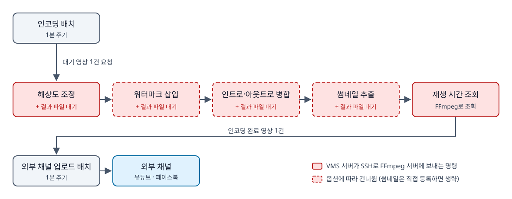

안녕하세요. 한국일보에서 기사작성시스템인 CMS 백엔드개발을 담당하고 있는 김유정입니다.

한국일보에는 VMS(Video Management System)라는 영상 관리 시스템이 있습니다. 기사 본문에 넣을 영상과 홈페이지에 노출할 영상은 모두 VMS에 등록합니다. VMS는 등록된 영상을 한국일보 홈페이지뿐 아니라 유튜브, 네이버 TV, 페이스북 같은 외부 채널로도 전송합니다.

VMS는 필요한 영상만 전송 전에 인코딩합니다. 인코딩은 영상 앞뒤에 한국일보 인트로와 아웃트로를 붙이고 화면 구석에 로고 워터마크를 넣는 작업입니다. 이 세 가지는 영상마다 사용 여부를 정할 수 있고, 하나도 사용하지 않는 영상은 인코딩 없이 바로 전송됩니다.

인코딩을 직접 운영하던 ffmpeg 서버에서 AWS Elemental MediaConvert 서버리스 환경으로 전환하게 됐습니다. 다만 ffmpeg의 한계 때문에 전환한 것은 아닙니다. 지연의 상당 부분은 서버 간 파일 공유 방식에서 발생했고, 인코딩할 영상이 많지 않고 길이와 용량이 불규칙한 환경에서는 서버리스 방식이 적합하다고 판단했습니다. 이 글에서는 기존 영상 업로드 구조의 문제점과 MediaConvert 전환을 결정하게 된 이유 및 전환 후 구조를 정리합니다.

## 영상 업로드가 너무 느려요

VMS를 운영하면서 현업에서 영상 업로드 단계가 너무 느리다는 불만이 있었습니다. 영상을 등록한 뒤 외부 채널에 올라가기까지 시간이 오래 걸린다는 것이었습니다. 원인을 추적하는 과정에서 인코딩 단계의 문제를 확인했고, 인코딩 구조를 개선하는 작업을 진행했습니다.

## 가장 느린 부분 찾기

영상이 등록된 뒤 외부 채널로 나가기까지는 세 단계를 거칩니다.

어느 단계에서 시간이 걸리는지 확인하기 위해 운영 환경에서 처리된 영상 10건의 단계별 소요 시간을 측정했습니다. 영상 길이는 30초에서 2분 43초 사이였습니다.

<table style="display: table; width: 100%">
  <thead>
    <tr>
      <th>단계</th>
      <th>소요 시간 (10건)</th>
      <th>전체 대비 비중</th>
    </tr>
  </thead>
  <tbody>
    <tr>
      <td>인코딩</td>
      <td>2분 40초 ~ 11분 12초</td>
      <td>약 78%</td>
    </tr>
    <tr>
      <td>영상 저장소 업로드</td>
      <td>0초 ~ 55초</td>
      <td>약 8%</td>
    </tr>
    <tr>
      <td>외부 채널 전송</td>
      <td>1초 ~ 1분 8초</td>
      <td>약 13%</td>
    </tr>
  </tbody>
</table>

10건 모두 인코딩이 가장 오래 걸렸습니다. 영상 한 건의 전체 소요 시간은 3분 10초에서 12분 42초였고, 그중 인코딩이 차지하는 비중은 건별로 57%에서 97%였습니다.

인코딩 시간은 영상 길이에 비례하지 않았습니다. 30초 영상의 인코딩에 3분 5초가 걸렸고, 1분 23초 영상은 2분 54초가 걸렸습니다. 영상 길이와 무관하게 몇 분씩 걸린다는 것은 인코딩 연산 외에 다른 시간이 포함되어 있다는 뜻입니다. 그래서 인코딩 단계를 세부 단계로 나눠 확인했습니다.

## 인코딩 단계는 왜 느릴까

### 단계별 실행 시간

인코딩은 해상도 조정, 워터마크 삽입, 인트로·아웃트로 병합, 썸네일 추출의 네 단계로 나뉘고, 단계마다 ffmpeg 명령을 한 번씩 실행합니다. 길이와 용량이 다른 영상으로 단계별 소요 시간과 그중 결과 파일을 기다린 시간을 측정했습니다.

ffmpeg 명령 자체는 1\~2초 안에 빠르게 끝났지만, 결과 파일이 확인되기까지의 딜레이가 3\~30초 정도 소요되는 문제를 확인했습니다. 6초 영상도 네 단계를 거치면 2분 이상 소요됐습니다.

<table style="display: table; width: 100%">
  <thead>
    <tr>
      <th>단계</th>
      <th>6초 영상 (1.6MB)</th>
      <th>3분 35초 영상 (109MB)</th>
    </tr>
  </thead>
  <tbody>
    <tr>
      <td>해상도 조정</td>
      <td>32.8초 (대기 30초)</td>
      <td>1분 49.8초 (대기 3초)</td>
    </tr>
    <tr>
      <td>워터마크 삽입</td>
      <td>32.7초 (대기 30초)</td>
      <td>1분 46.7초 (대기 3초)</td>
    </tr>
    <tr>
      <td>인트로·아웃트로 병합</td>
      <td>31.8초 (대기 30초)</td>
      <td>1분 46초 (대기 3초)</td>
    </tr>
    <tr>
      <td>썸네일 추출</td>
      <td>30.4초 (대기 30초)</td>
      <td>30.6초 (대기 30초)</td>
    </tr>
  </tbody>
</table>

대기 시간에는 일정한 패턴이 있었습니다. 실행이 30초보다 오래 걸린 단계는 대기가 3초였고, 실행이 빨리 끝난 단계만 약 30초를 대기했습니다. 영상 길이가 짧을수록 대기의 비중이 커졌습니다.

### 단계별 딜레이 원인

대기가 생긴 지점을 찾기 위해 VMS가 각 단계의 완료를 판단하는 방식을 확인했습니다.

인코딩은 VMS 서버가 아닌 별도의 ffmpeg 서버에서 실행됩니다. VMS 서버는 ffmpeg 서버에 SSH로 접속해 명령을 실행하고, 두 서버는 NAS 볼륨을 NFS로 함께 마운트해 원본과 결과 파일을 주고받습니다. ffmpeg가 완료를 출력한 뒤에도 VMS 서버에서는 결과 파일이 즉시 확인되지 않았습니다. 그래서 VMS 서버는 단계마다 3초 간격으로 결과 파일의 크기를 확인하고, 0보다 커지면 다음 단계로 진행했습니다.

측정된 대기 3초는 첫 확인에서 파일을 찾은 경우이고, 약 30초는 같은 확인을 여러 번 반복한 경우입니다. 즉 ffmpeg 서버가 파일을 이미 생성했는데도 VMS 서버가 약 30초 동안 파일을 인식하지 못하고 있었습니다.

### NFS 속성 캐시

이 딜레이는 리눅스 NFS 클라이언트의 디렉터리 캐시 동작으로 인한 이슈로 파악했습니다.

VMS 서버는 ffmpeg를 실행하기 전에 같은 이름의 결과 파일이 있는지 확인하고, 있으면 삭제합니다. 이 시점에 VMS 서버의 NFS 클라이언트에는 해당 파일이 없다는 조회 결과가 캐시됩니다. 리눅스 NFS 클라이언트는 이 조회 결과를 상위 디렉터리의 속성 캐시가 만료될 때까지 유효하다고 판단합니다(`lookupcache` 기본값 `all`). 디렉터리 속성 캐시의 유지 시간은 기본값 기준 최소 30초, 최대 60초입니다(`acdirmin`, `acdirmax`). 따라서 ffmpeg 서버가 결과 파일을 생성해도, VMS 서버는 디렉터리 캐시가 만료되기 전까지 파일이 없다고 판단합니다.

NAVER Cloud Platform의 NAS 마운트 가이드는 `vers=3`과 `defaults` 옵션만 안내하며, 캐시 관련 옵션은 다루지 않습니다. 캐시 옵션을 따로 지정하지 않으면 위 기본값이 적용됩니다.

**이 대기는 ffmpeg의 한계가 아니라 파일 공유 방식에서 발생했습니다.** 존재하지 않는다는 조회 결과를 매번 다시 확인하는 `lookupcache=positive` 마운트 옵션을 적용하거나, 파일 확인을 ffmpeg 서버에서 수행하면 줄일 수 있는 대기였습니다.

### 기존 인코딩 환경

원인이 파일 공유 방식에 있다면 마운트 옵션만 바꿔도 대기는 줄어듭니다. 그러나 대기를 줄이는 것만으로 충분한지 판단하려면 인코딩 환경 전체를 다시 확인해야 했습니다. 기존 환경을 개선해 계속 사용할지, 다른 방식으로 전환할지를 정하기 위해 처리 구조부터 검토했습니다.

1분 주기 인코딩 배치가 대기 중인 영상을 한 건씩 조회해 VMS 서버에 전달하고, VMS 서버는 그림의 단계를 차례로 실행했습니다. 각 단계는 별도의 ffmpeg 명령이고, 해상도 조정, 워터마크 삽입, 인트로·아웃트로 병합은 각각 영상 전체를 다시 인코딩합니다. 영상 한 건을 처리할 때 영상 전체를 세 번 인코딩하는 구조였습니다.

#### 동시 처리

인코딩 배치는 진행 중인 건이 있으면 새 영상을 전달하지 않았습니다. 따라서 한 번에 한 건씩만 처리했습니다.

같은 서버에서 두 건을 동시에 실행하면 두 작업 모두 처리 시간이 늘었기 때문입니다. 2분 23초 영상의 해상도 조정은 단독 실행 시 1분 37초가 걸렸지만, 다른 작업과 동시에 실행하면 약 2분 40초로 늘었습니다.

인코딩은 CPU 사용량이 높은 작업입니다. ffmpeg는 스레드 수를 지정하지 않으면 서버의 코어를 최대한 사용하므로, 두 작업이 같은 CPU를 분할해 사용했습니다. 동시 처리 건수를 늘려도 서버 한 대가 처리할 수 있는 총량은 늘지 않습니다.

## 기존 환경 개선 VS 서버리스 환경 전환

기존 환경을 개선하는 방향과 서버리스 환경으로 전환하는 방향을 검토했습니다.

### 환경 비교

AWS Elemental MediaConvert는 AWS가 관리하는 파일 기반 영상 변환 서비스입니다. 서버 없이 작업 단위로 인코딩을 요청합니다.

<table style="display: table; width: 100%">
  <thead>
    <tr>
      <th style="white-space: nowrap">구분</th>
      <th>ffmpeg</th>
      <th>MediaConvert</th>
    </tr>
  </thead>
  <tbody>
    <tr>
      <td style="white-space: nowrap">특징</td>
      <td>
        • 인코딩 명령과 처리 흐름을 직접 제어
        • 처리 총량은 서버 한 대의 자원에 따라 달라짐
        • 처리량과 관계없이 서버 비용 고정
      </td>
      <td>
        • 작업마다 독립 실행되어 여러 영상을 동시에 처리
        • 완료를 작업 상태 변경 이벤트로 확인하므로 공유 볼륨에서 결과 파일을 기다리지 않음
        • 처리한 영상 길이만큼 과금
      </td>
    </tr>
    <tr>
      <td style="white-space: nowrap">장점</td>
      <td>
        • 기존 인코딩 명령과 처리 흐름을 그대로 사용
        • 증설을 제외한 개선은 서버를 늘리지 않고 적용 가능
      </td>
      <td>
        • 인코딩 서버를 운영하지 않음
        • 앞 영상의 처리가 끝나기를 기다리지 않고, 파일 확인 대기도 없음
        • 처리량이 적으면 비용도 적음
      </td>
    </tr>
    <tr>
      <td style="white-space: nowrap">단점</td>
      <td>
        • 단계 통합과 설정 조정 뒤에도 처리 총량은 서버 한 대의 CPU로 제한
        • 동시 건수가 늘면 건당 처리 시간도 증가
        • 프리셋 변경이 화질과 용량에 영향
        • 대기열 정책을 바꿔도 긴 영상의 처리 시간은 그대로이며, 긴 영상이 몰리면 다시 대기 발생
        • 상한을 넘으려면 증설이 필요하고, 증설하면 업로드가 적은 시간에도 비용이 고정으로 발생
      </td>
      <td>
        • ffmpeg 명령을 작업 설정으로 옮기고 Lambda와 상태 연동을 새로 구현해야 함
        • 처리량이 늘면 비용도 함께 증가
      </td>
    </tr>
    <tr>
      <td style="white-space: nowrap">비용 구조</td>
      <td>
        • 서버 비용 고정
      </td>
      <td>
        • 처리한 영상 길이만큼 과금
      </td>
    </tr>
    <tr>
      <td style="white-space: nowrap">해야 할 일</td>
      <td>
        • 단계별 딜레이 제거: <code>lookupcache=positive</code> 마운트 옵션 적용 또는 결과 파일 확인을 ffmpeg 서버에서 수행
        • 인코딩 단계 통합: 해상도 조정, 워터마크 삽입, 인트로·아웃트로 병합을 한 번의 인코딩으로 처리해 영상당 인코딩 횟수를 세 번에서 한 번으로 축소
        • 인코딩 설정 조정: 프리셋과 스레드 수를 지정해 건당 CPU 사용량을 줄이고, 동시 실행 시 코어를 나눠 할당
        • 대기열 정책 변경: 짧은 영상 우선 처리 또는 길이별 대기열 분리
        • 서버 관리: 인코딩 서버 상시 운영, 처리량이 부족하면 서버 사양·대수 증설
      </td>
      <td>
        • 작업 설정 작성: 해상도 조정, 워터마크 삽입, 인트로·아웃트로 병합, 썸네일 추출을 작업 설정(JSON)으로 이전
        • 작업 생성 Lambda: 원본이 S3에 업로드되면 VMS에서 인코딩 옵션을 조회해 작업 생성
        • 이벤트 연동: 작업 상태 변경 이벤트를 받아 진행 중, 실패, 완료를 VMS에 전달하는 Lambda와 이를 수신하는 VMS API 구현
        • 비용 관리: 처리하는 영상 길이로 비용 추정
      </td>
    </tr>
  </tbody>
</table>

### 서버리스 전환

두 방식 모두 지연을 줄일 수 있었습니다. 선택의 기준은 VMS의 영상 업로드 주기와 규모였습니다.

전환을 검토하면서 월별 영상 등록 건수와 인코딩 건수를 집계했습니다. 월 등록 건수는 5\~78건이었고, 그중 인코딩 옵션을 사용한 영상은 월 4\~35건이었습니다. 한 달 동안 인코딩한 영상의 재생 시간을 합해도 가장 많은 달이 약 50분이었습니다.

- 인코딩할 영상이 적고 달마다 건수의 차이가 큽니다. 인코딩 서버는 대부분의 시간 동안 유휴 상태이지만 상시 운영해야 합니다
- 영상 길이와 용량이 일정하지 않습니다. 짧은 영상은 빠르게 끝나지만, 긴 영상 한 건이 서버를 오래 점유합니다
- 점유하는 동안 이후에 등록된 영상은 모두 대기합니다. 대기 시간은 앞선 영상의 길이에 따라 달라집니다

서버 사양을 높이거나 대수를 늘리면 대기는 줄어듭니다. 그러나 업로드가 적은 환경에서는 유휴 자원도 함께 늘어납니다. 가장 긴 영상에 맞춰 사양을 정하면 평상시에는 자원이 남고, 평상시에 맞추면 긴 영상이 등록될 때 대기가 길어집니다. **업로드가 적고 불규칙한 환경에는 고정 용량 서버가 적합하지 않았습니다.**

비용도 함께 추정했습니다. Lambda는 영상 한 건을 처리하는 데 세 번 실행되고 실행 시간 합계는 약 20초입니다. 월 50건을 기준으로 계산하면 무료 제공량 안에 들어가 비용이 발생하지 않습니다. MediaConvert는 처리한 영상의 재생 시간만큼 과금되며, 월별 인코딩 재생 시간을 기준으로 월 1만 원 이내로 예상했습니다. 서버를 상시 운영하는 것보다 사용량 기반 과금 방식이 이 환경에 적합하다고 판단해 MediaConvert를 선택했습니다.

## 서버리스 환경으로

### 아키텍처

VMS가 원본을 S3에 업로드하면 업로드 이벤트가 Lambda를 호출해 MediaConvert 작업을 생성합니다. 결과 영상과 썸네일은 별도의 버킷에 저장됩니다. 작업 상태가 바뀔 때마다 별도의 Lambda가 VMS에 결과를 통지합니다.

VMS는 영상 등록이 끝난 뒤에 원본을 S3에 업로드합니다. 등록 전에 업로드하면 작업 생성 Lambda가 인코딩 옵션을 조회할 때 데이터가 아직 없을 수 있기 때문입니다. 업로드 즉시 영상 상태를 인코딩 중으로 변경해, 기존 배치가 같은 영상을 중복으로 처리하지 않게 했습니다.

### 작업 상태 연동

MediaConvert 작업 상태는 세 가지로 수신합니다.

<table style="display: table; width: 100%">
  <thead>
    <tr>
      <th>작업 상태</th>
      <th>VMS 처리</th>
    </tr>
  </thead>
  <tbody>
    <tr>
      <td>진행 중</td>
      <td>영상 상태를 인코딩 중으로 저장하고 이력을 남김</td>
    </tr>
    <tr>
      <td>실패</td>
      <td>인코딩 실패로 저장하고 이력을 남김</td>
    </tr>
    <tr>
      <td>완료</td>
      <td>영상·썸네일 경로와 재생 시간을 저장하고, 결과물을 내려받아 다음 전송에 사용</td>
    </tr>
  </tbody>
</table>

### 고려 사항

MediaConvert 작업을 어디에서 생성할지에 따라 두 가지 구조를 검토했습니다.

<table style="display: table; width: 100%">
  <thead>
    <tr>
      <th>구조</th>
      <th>작업 생성 방식</th>
      <th>고려할 점</th>
    </tr>
  </thead>
  <tbody>
    <tr>
      <td>Lambda 중심</td>
      <td>원본 업로드 이벤트로 호출된 Lambda가 VMS에서 인코딩 옵션을 조회해 작업을 생성</td>
      <td>VMS에 인코딩 옵션 조회 API와 작업 상태 수신 API가 필요</td>
    </tr>
    <tr>
      <td>VMS 중심</td>
      <td>VMS 서버가 AWS SDK for Java로 직접 작업을 생성</td>
      <td>작업 설정을 바꿀 때마다 VMS 배포가 필요하고, 작업 설정을 JSON 대신 SDK 객체로 구성해야 함</td>
    </tr>
  </tbody>
</table>

Lambda 중심 구조를 선택했습니다. 작업 설정을 JSON 그대로 사용할 수 있고, 설정을 바꿔도 VMS를 배포하지 않아도 됩니다. 인코딩할 영상이 적어 두 구조의 부하 차이는 크지 않았습니다. 적은 건수를 위해 VMS에 인코딩 코드를 추가하기보다, 인코딩 과정 전체를 AWS 서비스 안에서 관리하는 것이 운영에 적합하다고 판단했습니다.

#### 환경별 이벤트 분기

원본 버킷과 Lambda는 개발, 스테이징, 운영 환경별로 따로 구성했습니다. 반면 MediaConvert 작업 상태 변경 이벤트는 AWS 서비스 이벤트라서 기본 이벤트 버스로만 전달됩니다. 환경별로 이벤트 버스를 나눌 수 없으므로, 이벤트를 받은 뒤 어느 환경에서 생성한 작업인지 구분해야 했습니다.

환경을 구분하는 방법으로 세 가지를 검토했습니다.

- VMS API 하나가 모든 이벤트를 받아 환경별로 다시 전달하는 방법
- 모든 환경의 VMS API가 이벤트를 받고, 각자 자기 환경의 이벤트만 처리하는 방법
- 작업을 생성할 때 사용자 메타데이터(`userMetadata`)에 실행 환경을 넣고, 상태 전달 Lambda가 이 값을 읽어 해당 환경의 VMS API를 호출하는 방법

이벤트를 받는 대상이 VMS 하나뿐이고 늘어날 계획도 없어, 세 번째 방법을 선택했습니다. 환경 구분이 Lambda 안에서 끝나므로 VMS는 자기 환경의 이벤트만 받습니다. 작업 생성 Lambda가 작업을 만들기 전에 실패하면 MediaConvert 이벤트가 발생하지 않습니다. 이 경우에는 Lambda가 실패 이벤트를 직접 만들어 같은 경로로 VMS에 전달합니다.

#### 원본 보관

인코딩이 끝나면 원본은 결과 영상으로 대체되어 다시 사용할 일이 거의 없습니다. 다만 결과 영상에 문제가 생기는 경우에 대비해, 원본은 일정 기간 보관한 뒤 삭제하기로 했습니다.

원본 파일 이름은 영상 ID와 등록 이력 ID를 조합해, 업로드할 때마다 고유한 이름을 갖게 했습니다. 같은 영상이라도 업로드 시점마다 별도 파일이 되므로 보관 기간이 서로 섞이지 않고, 문제가 생기면 이력에서 해당 원본을 바로 찾을 수 있습니다.

#### 워터마크와 회전

ffmpeg 명령을 작업 설정으로 옮기는 과정에서 워터마크와 영상 방향을 다시 맞춰야 했습니다.

- 워터마크: 세로 영상처럼 비율이 다른 영상을 1920x1080에 맞추면, 입력 설정에 넣은 워터마크도 함께 늘어났습니다. 워터마크를 출력 설정으로 옮기고 시작 시각과 길이를 지정해, 본 영상에만 들어가고 인트로와 아웃트로에는 들어가지 않게 했습니다. 시작 시각을 지정했을 때 워터마크가 삽입되지 않는 문제는 작업의 타임코드 설정(`TimecodeConfig`)을 함께 지정해 해결했습니다
- 회전: 휴대폰으로 세로 촬영한 영상이 90도 돌아간 상태로 병합됐습니다. 이런 영상은 화면이 회전된 상태로 저장되고 회전 정보가 메타데이터로 함께 기록되어, 재생기가 이 정보를 적용해야 바르게 보입니다. 입력 설정의 회전 옵션(`Rotate`)을 자동으로 지정해, MediaConvert가 회전 정보를 읽어 바른 방향으로 인코딩하게 했습니다

## 얼마나 개선이 됐을까

전환 전에 같은 영상으로 두 방식의 인코딩 시간을 측정했습니다. 인코딩 옵션을 모두 사용하고 썸네일을 추출하는 조건이며, 업로드 시간은 제외하고 인코딩 시간만 비교했습니다.

<table style="display: table; width: 100%">
  <thead>
    <tr>
      <th>케이스</th>
      <th>AS-IS</th>
      <th>TO-BE</th>
      <th>개선</th>
    </tr>
  </thead>
  <tbody>
    <tr>
      <td>6초, 1.6MB</td>
      <td>2분 7초</td>
      <td>6초</td>
      <td>21.2배</td>
    </tr>
    <tr>
      <td>9초, 2.5MB</td>
      <td>2분 4초</td>
      <td>7초</td>
      <td>17.7배</td>
    </tr>
    <tr>
      <td>2분 23초, 60MB</td>
      <td>5분 7초</td>
      <td>41초</td>
      <td>7.5배</td>
    </tr>
    <tr>
      <td>3분 35초, 109MB</td>
      <td>5분 53초</td>
      <td>58초</td>
      <td>6.1배</td>
    </tr>
    <tr>
      <td>7분 46초, 1.2GB</td>
      <td>8분 22초</td>
      <td>1분 39초</td>
      <td>5.1배</td>
    </tr>
    <tr>
      <td>19분, 2.2GB</td>
      <td>28분 21초</td>
      <td>4분 39초</td>
      <td>6.1배</td>
    </tr>
    <tr>
      <td>2분 23초 + 7분 46초 동시 등록</td>
      <td>14분 23초</td>
      <td>1분 59초</td>
      <td>7.3배</td>
    </tr>
  </tbody>
</table>

짧은 영상은 17\~21배, 1GB가 넘는 영상은 5\~6배 빨라졌습니다. 짧은 영상의 차이는 대부분 단계별 딜레이에서 발생했습니다. 6초 영상의 AS-IS 처리 시간 2분 7초 중 약 2분이 단계별 대기였습니다. 긴 영상과 동시 등록의 차이는 서버 한 대의 처리 총량 한계에서 발생했습니다. 동시 등록한 두 영상은 AS-IS에서는 순차적으로 처리됐지만, TO-BE에서는 병렬로 처리되어 긴 영상 한 건과 비슷한 시간에 끝났습니다.

## 마치며

- 업로드가 느리다는 불만은 단계별 소요 시간을 측정하자 인코딩이라는 구체적인 구간으로 좁혀졌습니다. 개선 대상은 측정으로 정해야 합니다
- 처리가 느린 원인이 도구인지 주변 구조인지 구분해야 합니다. 단계별 30초 대기는 ffmpeg가 아니라 NFS 클라이언트의 디렉터리 캐시에서 발생했습니다
- 기존 환경 안에서도 마운트 옵션, 단계 통합, 인코딩 설정, 대기열 정책으로 개선할 여지가 있었습니다. 다만 처리 총량의 상한은 서버 한 대의 CPU로 남습니다
- 업로드 빈도와 영상 크기가 불규칙하면, 서버 사양을 맞추는 대신 서버리스를 먼저 검토할 가치가 있습니다. 판단 기준은 도구의 우열이 아니라 영상 업로드 주기와 규모였습니다
